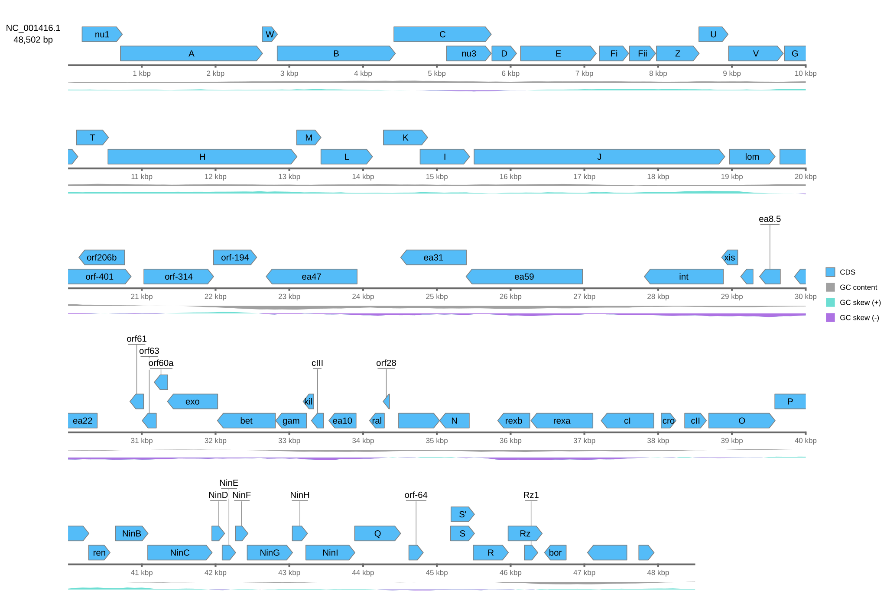
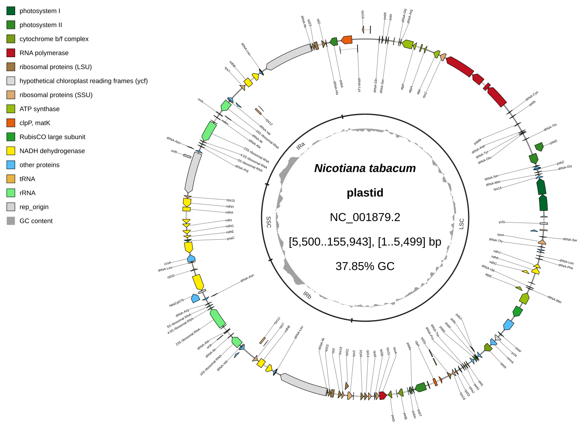

[Documentation home](../DOCS.md) | [Tutorials](../TUTORIALS/README.md) | [Technical documentation](README.md) | [Generated option inventory](../CLI_Reference.md) | [FAQ](../FAQ.md)

# Command line

The executable has five entry points:

| Command | Purpose |
|---|---|
| `gbdraw circular` | Draw one Circular result, a multi-record canvas, or a batch of Circular results. |
| `gbdraw linear` | Draw one ordered Linear result with optional comparisons. |
| `gbdraw render` | Render the drawings of a saved Session. |
| `gbdraw setup-losat` | Install the pinned native LOSAT release for LOSAT comparisons. |
| `gbdraw gui` | Serve the packaged web application locally. |

Run `gbdraw --help`, `gbdraw circular --help`, or `gbdraw linear --help` for
the option inventory generated by the installed version. The [generated
command-line option inventory](../CLI_Reference.md) records every current flag.
This page documents current command semantics.

## Install native LOSAT

`gbdraw setup-losat` explicitly downloads the pinned official LOSAT v0.1.0
archive for Linux x64, Windows x64, macOS arm64, or macOS x64. A 64-bit Python
is required; Intel Python running under Rosetta selects the x64 asset.
Linux requires glibc 2.34 or newer.
Linux/Windows ARM64 and musl/Alpine are not supported. The minimum OS versions
are not final until the release has been tested on each platform. gbdraw does
not claim signing or notarization.

gbdraw ships a lock file that pins the published v0.1.0 source commit and the
archive and binary hashes for each target. Setup verifies the archive SHA-256 before reading its
members, accepts only the expected release contents, verifies the binary hash
and `--version`, then atomically installs it. It keeps the executable named `LOSAT`
(`LOSAT.exe` on Windows). The cache locations are:

- Linux: `$XDG_CACHE_HOME/gbdraw/losat/0.1.0/<target>` (default `~/.cache`).
- macOS: `~/Library/Caches/gbdraw/losat/0.1.0/<target>`.
- Windows: `%LOCALAPPDATA%/gbdraw/losat/0.1.0/<target>`.

Searches never download. Automatic native selection uses this order:

1. `--losat_bin` or an explicit `--ncbi_blast_bin`;
2. lowercase `bin/losat` in the running Python's conda prefix;
3. the verified managed cache;
4. `losat` on `PATH`;
5. the NCBI BLAST+ program of the search (`blastn`, `tblastx`, or `blastp`) on `PATH`.

gbdraw recognizes a conda prefix only when `Path(sys.prefix) / "conda-meta"` is a
directory. It does not use `CONDA_PREFIX`, `PATH`, or
`sys.base_prefix` to identify that environment, and it does not call the conda
CLI. A present conda candidate that is a broken link, not a regular file, or
not executable fails with its path; gbdraw does not modify it or silently use a
different backend. If the candidate is absent, normal fallback continues.

The string `losat` remains the automatic-selection token for compatibility.
Pass an absolute path such as `--losat_bin /absolute/path/LOSAT` to force a
specific executable. A corrupt managed cache still stops with its directory and
cause when fallback reaches it. To repair it, remove that version/target
directory and rerun setup. When another installer is running at the same time, setup stops with a
message; run it again afterwards.
gbdraw never treats an interrupted temporary download as an installation.
Later setup runs and searches reuse a valid cache offline. `INSTALL.json` records the URL,
version, target, source commit, archive hash and binary hash.

Every native LOSAT executable must support CLI v2, the released v0.1.0
spelling (`-query_gencode`, `-db_gencode`, `-max_hsps`, `-max_target_seqs`,
and `-num_threads`).

Native executables are excluded from the platform-independent wheel and sdist.
Conda installs executables under its environment's `bin` directory;
gbdraw's PyPI metadata has no native LOSAT dependency. A source checkout has
no LOSAT binary either; run `gbdraw setup-losat` there too. The run log has one
`INFO` line per search that names the backend (`losat` or `ncbi-blast`), its
source (`explicit`, `conda`, `managed`, or `path`), and the executable. The web
app's Wasm execution and assets are unchanged.


## Shared input rules

GenBank and GBFF files use `--gbk`, including DDBJ records downloaded in
GenBank flat-file format and EMBL flat files
([input formats](input-formats-and-tsv-schemas.md#sequence-and-annotation-files)). GFF3
uses `--gff` with a positionally matched `--fasta` list. A `--records_table`
replaces those direct path lists and stores source paths and record-specific
settings together. Relative paths inside any manifest resolve from the
manifest's directory.

Repeated input settings are positional. Labels, subtitles, selectors,
reverse-complement flags, regions, depth sources, and comparison edges must map
to the intended displayed record after selection and ordering. Use a manifest
when it makes these record-to-setting relationships easier to verify. See
[Input formats and TSV
schemas](input-formats-and-tsv-schemas.md).

## Record selection and layout

Linear mode selects and crops records with `--record_id`, `--region`, and
`--reverse_complement`; `gbdraw circular` does not accept them.
`--record_id` selects a record by ID or `#index` for each input file.
`--region` accepts `record_id:start-end[:rc]`, `#index:start-end[:rc]`, or
`file:record_selector:start-end[:rc]`. Coordinates are 1-based and inclusive.
A start greater than the end selects the region from end to start and draws it
reverse-complemented, as `:rc` does: `rec:500-100` is `rec:100-500:rc`.
Repeated `--reverse_complement` values follow input-file order and accept the
boolean tokens listed by `--help`. A region is cropped first, on the record as
stored in the file, and then reverse-complemented: `--region '#2:5001-40000'`
with `--reverse_complement 1` for that file draws the same window as
`--region '#2:5001-40000:rc'`. Selection, cropping, and reverse-complement
display do not rewrite a source file. `gbdraw linear --auto_orient` also
reverse-complements each record whose reverse nucleotide hits against the row
above weigh more than half of its hits; an explicit reverse wins, and protein
comparisons are not read. The rule is in [Automatic Linear
orientation](comparison-programs-thresholds-and-results.md#automatic-linear-orientation).

Circular mode writes separate results for multiple records by default.
`--multi_record_canvas` places them on one canvas.
`--multi_record_size_mode` accepts `auto`, `linear`, or `equal`; `equal` uses
one radius for all records. Repeat `--multi_record_position SELECTOR@ROW` once
per displayed record to assign rows. Input order is the left-to-right order
within each row. Every record must be assigned exactly once.

Linear mode also accepts one `--multi_record_position SELECTOR@ROW` per
displayed record. Records in one row share a bp-per-pixel scale and keep input
order. `--linear_record_gap` sets the gap within that row.
`--record_label` and `--record_subtitle` follow displayed-record order.
Multi-record rows cannot be combined with `--normalize_length`.

`gbdraw linear --anchor_feature KEY=VALUE` lines the records up at one
feature, for example `--anchor_feature gene=COX1` across mitogenomes. The
selector has the `feature_selector` form of the placement and override tables
and matches a qualifier value exactly; `locus_tag=` and `gene=` are the usual
keys. It is resolved in each record as drawn, after `--region`,
`--reverse_complement`, and a display start. The anchor is the feature's
start as drawn: its 5' base when the feature reads rightward as drawn, and its
3' base otherwise, following its parts in biological order. For a feature in one
part that is its left end as drawn (on a reverse-complemented record, its end
with the higher source coordinate). A join starts on the part its path begins
with as drawn, even when another of its parts lies further left, and a feature
across the origin or a display start begins on its piece before that seam.
Only features that start inside the drawn region count. The first record
that has the feature keeps its place; every other record that has it moves
so that the feature's start lies directly below, and that place replaces the
record's own x, as with Similarity alignment. A record without the feature
keeps its place, with a warning naming it, or saying that its match starts
outside the drawn region. A gene and its CDS that start at the same base
count as one match; matches at different starts stop the run with the
candidates listed, and so does a selector that no record matches. With
`--align_center`, the first record keeps its centred place and the records the
anchor moves leave theirs. A moved record can widen the canvas. With
`--auto_orient`, the anchor is read after the automatic reverse complement.
`--anchor_feature` cannot be combined with `--similarity_alignment_feature`,
with records that share a row (`--multi_record_position`), or with a
`--wrap_length` that cuts a record. A saved Session stores the resulting
record translations, not the option.

On-axis ruler coordinates depend on the canvas topology. If any Linear row
contains multiple records, every ruler on that canvas uses record-local
distance and ascends from left to right, including rulers for
reverse-complemented records. When every row contains only one record, rulers
keep source-coordinate mapping, so a reverse-complemented region descends
from left to right.

`--track_layout above|below` with `--scale_style ruler` allows
`--ruler_on_axis`; other layout combinations ignore the on-axis ruler with a
warning. With `--wrap_length` that warning is not given: rows always have the
on-axis ruler, and with nothing to cut the flag has no effect. `--hide_scale`
hides genome-coordinate ticks and labels but keeps the record axes. Quantitative
axes remain independent, and `--hide_length` separately controls Linear
definition text.

### Wrap one record over several rows

`--wrap_length` draws each record longer than the given length over several
rows of that length, all at one scale. It takes a length in bp with an optional
unit (`10000`, `10kb`, `0.5Mb`) or `auto`, which picks 10, 20, or 50 kb so the
longest record takes at most five rows, and 50 kb when none does.

The option has no effect on a figure with nothing to cut. When no record is
longer than the row (or, under `auto`, none is longer than 10 kb), the figure and
the exit status are those of the same command without `--wrap_length`: the same
layout, the same scale style, and none of the refusals below. A figure draws
middle with a bar for a short genome and rows for a long one from the same
command.

The record stays one record. Each row has its own height from its own labels, a
cut feature keeps one identity and one label, on the row with its longest part,
and GC content, GC skew, and depth are computed over the whole record. A shorter
record in the same figure stays one row at the same scale.

When a record is cut, `--track_layout` defaults to `above`, `--scale_style` to
`ruler`, and the ruler stands on each row's axis. `--track_layout middle`, a
feature slot with `side=overlay`, `--scale_style bar`, `--normalize_length`,
comparison inputs, and several records in one `--multi_record_position` row are
refused, comparison inputs before any search runs. A wrapped figure can pass the
[PNG and PDF size limits](output-formats-and-export.md#png-and-pdf-size-limits).

<!-- executable:H-CLI-15:start -->
```bash
gbdraw linear \
  --gbk NC_001416.gb \
  --qualifier_priority cds_gene_qualifier_priority.tsv \
  --show_labels all \
  --resolve_overlaps \
  --gc \
  --skew \
  --wrap_length 10kb \
  --legend right \
  -o lambda_wrapped \
  -f svg
```
<!-- executable:H-CLI-15:end -->

The command writes `lambda_wrapped.svg` and logs `Wrapping at 10 kb per row: 5
rows`.



## Tracks, annotations, and presentation

Simple track flags build the default stack. Repeat `--circular_track_slot` or
`--linear_track_slot` for an explicit ordered stack. Circular mode also accepts
`--circular_track_table`. An explicit stack overrides the simple flags: its axis boundary,
renderer order, and source assignments replace the simple placement decisions.

Repeat `--depth_track` once per logical series. Give one path to reuse a series
for all records, or one path per displayed record. A quoted empty argument is
an explicit missing value for that record. Each series must contain at least
one real source.

`--annotation_table` supplies named coordinate- or feature-targeted sets. Bind
each set to an `annotations` slot. Styling flags and tables follow the
precedence in [Palettes, feature rules, labels, shapes, tracks, and
layout](palettes-feature-rules-labels-shapes-and-tracks.md).

`--feature_override_table` shows, hides, or relabels individual features named
by exact selectors; its rows decide before the visibility and label tables (see
[Feature override table](input-formats-and-tsv-schemas.md#feature-override-table)).

`--label_line` (`none`, `under`) and `--label_protection` (`none`, `halo`,
`box`) set how a feature label with a leader line is drawn. The defaults are
`under` and `box` in Linear, and `none` and `none` in Circular, which draws
no halo unless `halo` is chosen. `under` draws a
line under the letters of a horizontal label that continues the leader; a label
drawn turned (`--label_rotation` in Linear, radial labels in Circular) gets no
line, and its leader ends at the letters as with `none`. In Linear the line
lies on a white casing that cuts other labels' leaders where they cross it, and
each end stops 0.12 em inside the letters. `halo` draws a white outline 0.08 em wide around the
letters, so a leader behind them is cut away; `box` draws a white box at 80 %
opacity behind them, 0.18 em beyond the letters and stopping short of the
underline. A label drawn inside its feature gets no box. In Linear a turned
`above_feature` label that sits on its feature without a leader gets the box
too, and its sides toward the feature stop at the letters. Leaders and underlines are 0.07 em wide, at least 1 px. In
Linear, neighbouring feature labels in one label row keep at least 0.25 em of
their font size apart; a label that would come closer, or lie over its
record's definition text, takes another row, and the underline takes no room
in its label row. With `--label_placement
above_feature`, Linear draws each label over its own feature (below a
negative-strand feature with `--separate_strands`): a horizontal label starts
one row off its feature with a leader, as with `auto`, and a turned label sits
on its feature; labels move away from the axis off each other and off the
record's definition text, a horizontal label by whole `auto` rows. In both modes region labels keep
off a feature label's underline and box as off its letters.

`--italic_gene_labels` draws in italics each feature label that the qualifier
priority (`--qualifier_priority`, or the default order) takes from the `gene`
qualifier. The label stays italic when a `--label_table` row or a feature
override replaces its text; every other label stays upright. It is off by
default. gbdraw measures an italic label with the italic face of its font, as
the bundled Liberation fonts have, or with the regular face when the font has
no italic face.

gbdraw draws no background, so no option is needed for one: SVG output has no
background shape, and PNG output keeps it transparent. See
[Static, interactive, and raster output](output-formats-and-export.md#static-interactive-and-raster-output).

`--font_family` sets the font of all diagram text: one family name such as
`"DejaVu Serif"` or a CSS font-family list. The default is Liberation Sans.
gbdraw measures text with the font file of the first family it finds: a
`--font_file` font, a bundled Liberation font, or a font installed on the
computer. When the first family is found nowhere, gbdraw warns and draws the
next family it finds, else the nearest Liberation font. `--font_file PATH` adds the faces of a `.ttf`, `.otf`, `.ttc`,
or `.otc` file (every face of a collection); repeat it for more files. Without
`--font_family`, the diagram uses the family of the first file. An unreadable
file is an error. `circular`, `linear`, and `gbdraw render --session` accept
both; with `--session`, `--font_file` supplies the font the Session names.
`--no_font_embedding` keeps only the font name in SVG output. A Session stores
the font name, not the file; `--save_session` logs that for a custom font. See
[Fonts](output-formats-and-export.md#fonts).

## Comparison boundary

`gbdraw linear --losat losatn|tlosatx|losatp` runs the search itself with native
LOSAT or the matching NCBI BLAST+ program. Records in adjacent rows are compared
unless `--comparisons_table` lists `source` `losat` rows. `--losatn_task` selects
the LOSATN task and `--losat_gencode` the TLOSATX genetic code. `--losat losatp`
takes `--losatp_mode` (`similarity_groups`, `collinear`, or `pairwise`; default
`similarity_groups`). `gbdraw circular` builds Circular similarity rings with
`--losat losatn|tlosatx` and `--conservation_sequence`. As an alternative, read
prepared results with `--blast`, `--comparisons_table`, or
`--conservation_blast`; `--losat` cannot be combined with `--blast`. Each
`--blast` file belongs to one adjacent pair, so a
missing, unreadable, or malformed file stops the run instead of being skipped.
The table rules are in [Comparison and numeric
tables](input-formats-and-tsv-schemas.md#comparison-and-numeric-tables).

LOSATP Pairwise mode searches each record against each record of the next row,
the pairs Similarity groups and Collinear blocks draw. With one record per row
these are the consecutive records; it does not add an implicit first-to-last
comparison.

`--losat_output_dir DIR` (with `--losat`) writes the raw search rows of the run.
LOSATN and TLOSATX write one TSV per compared record pair and `comparisons.tsv`
(Linear), or one TSV per ring and `conservation.tsv` (Circular); `--comparisons_table`
and `--conservation_table` accept them unchanged. LOSATP writes the raw
protein-search rows from the Linear run to `DIR/losatp.raw.tsv` as one
deterministic, commented outfmt 6
file. The writer creates `DIR`, resolves session-internal runtime handles to
stable percent-encoded protein IDs, and refuses an existing `losatp.raw.tsv`
unless `--overwrite` is present. Display filters
and hit caps can make the number of drawn links smaller than the raw row count.

`--identity_scale MIN MAX` (both subcommands) fixes the identity colour scale
of the pairwise matches or similarity rings and their Legend, which otherwise
runs from `--identity` to 100%. See [Identity colour
scale](comparison-programs-thresholds-and-results.md#identity-colour-scale).

See [Comparison programs, thresholds, and result
semantics](comparison-programs-thresholds-and-results.md) for direction,
filtering, cache identity, and the limits of each result type.

### Strict Similarity Group alignment

In `gbdraw linear`, select `--losat losatp --losatp_mode similarity_groups` and
pass `--similarity_alignment_feature` an exact feature SVG hash or protein ID from the
chosen reference record. A Similarity Group ID is rejected. The CLI uses the
shared resolver: the sole usable member wins; with multiple members, only one
distinct direct reciprocal-best-hit (RBH) member connected to that exact
reference can win. RBH direction is symmetric. Missing or unusable members keep
their original position and orientation. Selected target anchor centers align
horizontally; the reference and every target's vertical position stay fixed.
The CLI preserves every record's orientation.

If a record still has multiple candidates, the command reports that record
and its exact candidate IDs as an error. It never prompts or silently accepts
a recommendation. Supply an unambiguous input or use Web **Select**/**Skip**.
The same completed protein analysis supplies both resolution and rendering;
Align does not start another LOSATP search. The Python API takes the same input
as `SimilarityAlignmentReference(feature_id=...)` and resolves it with the same
rules ([Python API reference](python-api.md#typed-linear-similarity-group-alignment)). Collinear alignment controls,
anchor TSV, scored inference, support-count ranking, and multi-hop automatic
selection are unsupported.

## Sessions and output

`--save_session` writes `<output>.gbdraw-session.json`;
`--session_output PATH` selects a `.json` or `.json.gz` path and implies save.
With `--session`, only output and format overrides, session-output options,
`--font_file`, `--no_font_embedding`, `--drawing`, and `--overwrite` are accepted; other diagram flags would mix
persisted and new settings.

A Session holds one or more drawings, one per diagram. Session 50 holds at most
a Circular drawing (ID `circular`) and a Linear drawing (ID `linear`).
`gbdraw render --session FILE` renders every drawing with a committed render
and skips a drawing without one (a settings-only Session) with a notice.
`--drawing ID` (repeatable, ID or name) renders only the named drawings; naming
a drawing without a committed render is an error. `--list_drawings` prints
`ID<TAB>mode<TAB>name<TAB>yes|no`, one line per drawing, and exits.
`gbdraw circular --session` and `gbdraw linear --session` render the Session's
only drawing of their mode; `--drawing ID` names it when there are several,
and a drawing of the other mode is an error that lists the drawings.

One drawing keeps the output names of the command that created the Session.
Several drawings write `<prefix>_<ID>`, where the prefix is the name part of
`-o` or each drawing's saved prefix; a Circular batch inside a drawing still
appends `_<n>`. Every diagram path and the Session output are checked together
before the first file is written. A re-save replaces the rendered drawings and
keeps the others; with several drawings, `--save_session` needs `-o`. Before
any render, the Session is brought to the current version and validated, so a
Session that cannot be saved again writes no diagram. A Session 31-39 saved no
feature catalog, so this drops its saved Results: the command prints a warning
that names each one, and the re-saved Session holds the Results of this render.
Its per-feature edits keyed by rendered ID move onto their features through its
GenBank sources read again, as a Web Load moves them; see
[Session and request compatibility](session-and-request-compatibility.md).
A Session 27-30 has one
drawing without a canonical request, which `gbdraw render` replays as its
mode's command does.

SVG is the base render. Additional formats are selected with `-f` or
`--format`. `-o` or `--output` accepts a path-like output prefix; its last
component is at most 200 bytes in UTF-8. Existing
diagram, session, and raw-result targets are rejected unless overwrite is
explicit. See [Output formats and
export](output-formats-and-export.md).

## Error behavior

Invalid input combinations, unknown schema columns, mismatched selectors,
impossible layouts, incompatible track stacks, and unsafe output paths fail
before a successful result is reported. A warning identifies an ignored or
adjusted combination; it does not make the requested combination valid.

### Input summary

After the figure is written, each run prints what it read and drew, one `INFO:`
line per drawn record and per comparison table:

```text
INFO: Record PROKKA01.1 (genome.gb), record 1 of 1, 1,001..2,000 of 3,000 bp: drew 3 features (1 CDS, 1 rRNA, 1 tRNA); left out 1 source (type not drawn).
INFO: Comparison table pair.tsv (record #1 PROKKA01.1 and record #2 RAST0001.1): kept 1 of 5 rows; 4 rows below bitscore 100 (best 90); 3 rows below identity 60% (best 58.4%).
```

A record line counts the features drawn per type, the features left out because
their type is not drawn (`-k/--features`, and for GFF3 the types read), and the
features a visibility rule or feature edit hides; a cropped record also names its
region, and gives the GFF3 types left out at load for the whole record, since the
load filters before the crop. A comparison line counts the rows each threshold (`--evalue`,
`--bitscore`, `--identity`, `--alignment_length`) leaves out, with the best value
among those rows. A row can fail more than one threshold. A LOSATP protein
comparison line counts the protein matches drawn (hits, collinearity blocks, or
reciprocal best-hit pairs, by mode) and no threshold, because the protein
analysis applies the thresholds itself.

A `WARNING:` line follows when a record has no feature to draw, naming its
feature types when it has some, and when the thresholds leave out every row of a
comparison table or the table has no rows. These runs still write the figure and
exit with status 0. A file with no record stops the run with an `ERROR:` line and
status 1, and nothing is written.

A UTF-8 byte order mark at the start of a GenBank, EMBL, GFF3, or FASTA file is
ignored, so the first record is read.

The command line, the Python API, and Web or Session requests share one set of
value checks. `--window`, `--step`, `--depth_window`, and `--depth_step` take
positive integers. `-n/--nt` and a track slot's `nt` take two letters from `A`,
`C`, `G`, `T`, and `U` in any case; `U` is counted as `T`, and track and legend
names keep the given letters in upper case, for example `AU skew`. Font sizes
must be greater than zero and stroke widths zero or greater; offsets, spacing,
`track_axis_gap`, and label rotation keep their current ranges. A rejected
value stops with an `ERROR:` line that names the option or setting instead of
drawing an empty or flat track or printing a traceback. An unknown `-f/--format`
token or `-p/--palette` name, or a palette name in `FeatureOptions(palette=...)`,
stops with an error that lists the accepted values; nothing is written. A
saved Session that stores an unknown palette name still draws with the default
palette, and a Session 27-30 whose saved arguments hold an unknown format token
still replays without it.

## Rotate a plastome and place a multipart feature

This example keeps the colors, radial labels and GC track of the
[annotated chloroplast tutorial](../TUTORIALS/build-an-annotated-chloroplast-map.md#on-the-command-line)
and marks the structural regions with brackets.
Start in an empty directory. Download the complete GenBank record from
[NCBI NC_001879.2](https://www.ncbi.nlm.nih.gov/nuccore/NC_001879.2), saving it as
`NC_001879.gbk` (155,943 bp, circular). Obtain two support tables:
`qualifier_priority.tsv` from that tutorial,
and the bracket table
[`nicotiana-tabacum-regions.tsv`](../../gbdraw/web/tutorial-data/tobacco-plastome-regions/nicotiana-tabacum-regions.tsv).

Create `tables/placements.tsv` with these complete contents (real tabs):

```tsv
record	feature_selector	placement	level
NC_001879.2	protein_id=NP_054479.1	outward	1
```

The unique protein ID selects the two-part rps16 CDS. Combined strands and the
split feature slot make Outward lane 1 available. The resolver allocates Auto
features after the fixed rps16 feature. Source base 5500 becomes the display
start; the source sequence and feature locations are unchanged.

<!-- executable:H-CLI-14:start -->
```bash
gbdraw circular \
  --gbk NC_001879.gbk \
  -t builtin:plastid \
  -k CDS,rRNA,tRNA,tmRNA,ncRNA,misc_RNA,rep_origin \
  --species '<i>Nicotiana tabacum</i>' \
  --track_type tuckin \
  --display_start_coordinate 5500 \
  --feature_placement_table tables/placements.tsv \
  --feature_overlap_tolerance_bp 1 \
  --resolve_overlaps \
  --gc \
  --no-skew \
  --labels both \
  --label_placement radial \
  --outer_label_x_radius_offset 0.9 \
  --outer_label_y_radius_offset 0.9 \
  --inner_label_x_radius_offset 0.975 \
  --inner_label_y_radius_offset 0.975 \
  --qualifier_priority qualifier_priority.tsv \
  --annotation_table nicotiana-tabacum-regions.tsv \
  --circular_track_slot 'features:features@side=overlay,lane_direction=split' \
  --circular_track_slot 'plastome_regions:annotations@set_id=plastome_regions,side=inside,r=0.65,w=20px,inner_gap_px=1,outer_gap_px=1,show_labels=true,padding_px=1,overflow=compress' \
  --circular_track_slot 'gc_content:dinucleotide_content@side=inside,r=0.56,w=0.08,nt=GC,legend_label=GC content' \
  --block_stroke_color black \
  --block_stroke_width 1 \
  --line_stroke_width 2 \
  --axis_stroke_width 3 \
  --definition_font_size 28 \
  --legend upper_left \
  -o rotated_placed_chloroplast \
  -f svg
```
<!-- executable:H-CLI-14:end -->

The command writes `rotated_placed_chloroplast.svg`. Inspect the complete plastome
and both rps16 parts in the outward lane. The start cuts its intervening intron;
all resulting fragments keep one placement. Tolerance 1 means conflicts require
more than one overlapping base. See the equivalent [literal Python
example](python-api.md#combined-rotation-and-placement-example).



For Linear use `--display_start_coordinate` with a complete circular record and
`above`/`below` on a combined-strand overlay slot. A direct start flag targets one
resolved record; use a [records table](input-formats-and-tsv-schemas.md#display-and-feature-placement-tables)
for multiple targets. `--record_topology auto|circular|linear` overrides topology. Unset adds no
shift; explicit 1 anchors source base 1 even after reverse complementation.
Crop and explicit start cannot be combined.

### Rotate a record to a feature

`gbdraw circular --origin_feature KEY=VALUE` rotates each record so that one
feature starts at 12 o'clock. On the tobacco plastome,
`--origin_feature gene=psbA` draws the same figure as
`--display_start_coordinate 536`. The selector has the `feature_selector` form
of the placement and override tables and matches a qualifier value exactly, as
`gbdraw linear --anchor_feature` does. The feature's start as drawn becomes the
display start: its 5' base when the feature reads clockwise as drawn, and its
3' base otherwise, following its parts in biological order. A minus-strand gene
therefore starts at its low source coordinate (psbA,
`complement(536..1597)`, starts at 536) and reads counterclockwise. To read it
clockwise from 12 o'clock, also reverse-complement the record (the records-table
`reverse_complement` column); its high coordinate (1597) then becomes the start.
A join starts on the part its path begins with as drawn: the trans-spliced
rps12 gene `complement(join(100062..100855,72224..72337))` starts at 100062, its
3' base, although its other part lies at 72224..72337. A feature across the
origin, such as `join(16024..16569,1..576)`, starts on its piece before the
origin, at 16024. The Web app's Rotate to feature, "Start of
the record", gives the same start.

The feature needs exact coordinates on one strand: an unstranded or
mixed-strand feature, a fuzzy end, `order()`, or overlapping parts stop the run.
A gene and its CDS that start at the same base count as one match; matches at
different starts stop the run with the candidates listed, and so does a
selector that no record matches. A record without the feature keeps its start,
with a warning naming it. `--origin_feature` cannot be combined with
`--display_start_coordinate` or a records-table `display_start`, with a crop (a
records-table `region`), or with a record drawn linear. A saved Session stores
the resulting display start, not the option.
