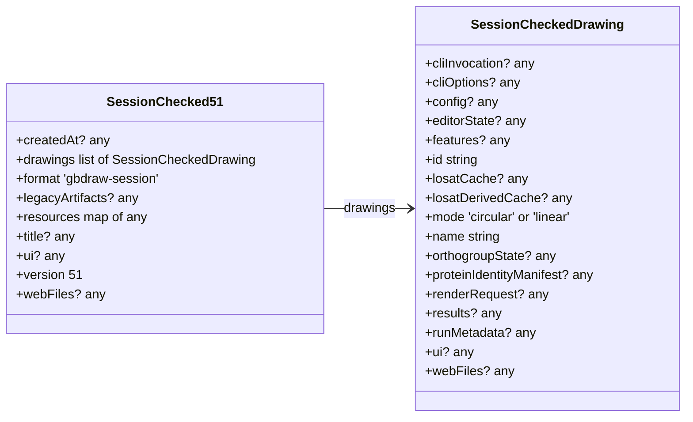
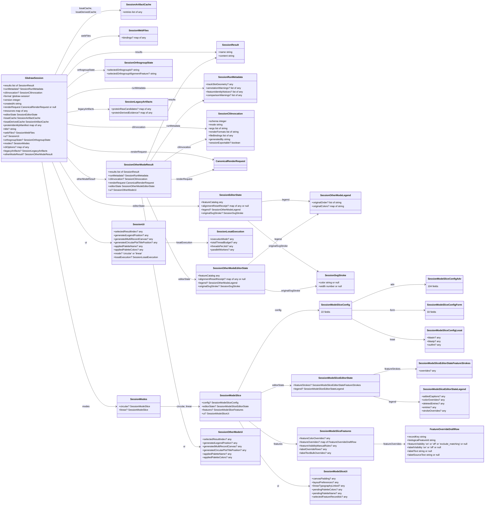
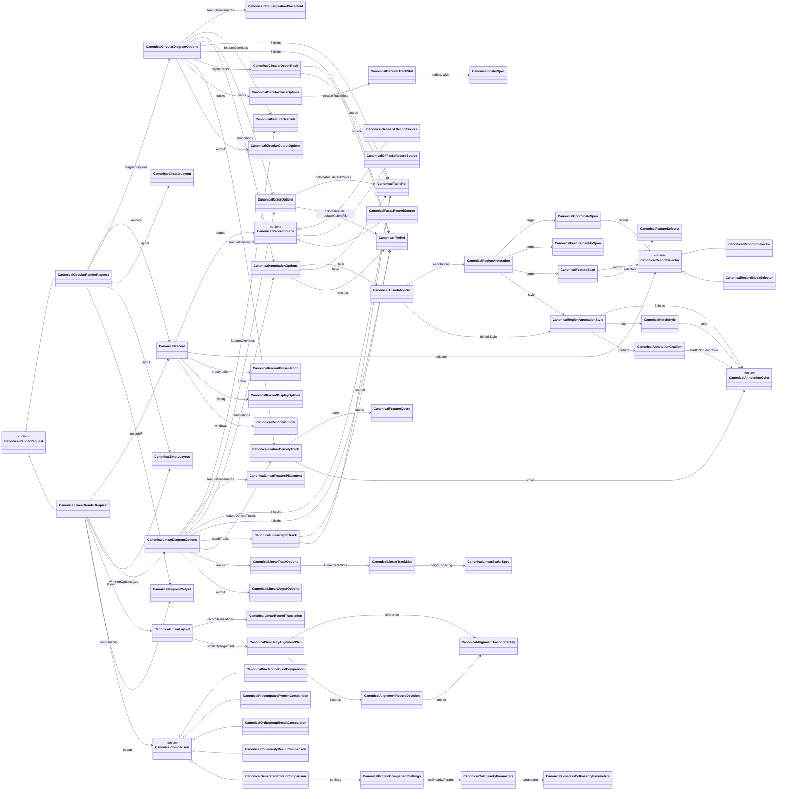

[Documentation home](../../DOCS.md) | [Tutorials](../../TUTORIALS/README.md) | [Technical documentation](../README.md) | [FAQ](../../FAQ.md)

# Session and request JSON Schema

<!-- Generated by tools/generate_web_contracts.py from gbdraw/session_contract.py and gbdraw/session_request_codec.py; do not edit manually. -->

- [`gbdraw-session.schema.json`](gbdraw-session.schema.json): a stored Session of any supported version (27–33, 39–42, 44, 46–51).
- [`gbdraw-render-request.schema.json`](gbdraw-render-request.schema.json): a canonical render request of schema 10.

Both are JSON Schema draft 2020-12. What gbdraw refuses outside them, and what it reads anyway, is in [Session and request structure](../session-and-request-compatibility.md#session-and-request-structure).

## Version bands of the Session reader

Each box is a band of `gbdraw-session.schema.json`: the versions it covers and the top-level keys it requires (`describe_session_admission()`).

## A Session 51 file

The project and its drawings as the reader checks them; it checks each drawing's parts on the drawing's one-drawing view (`describe_session_admission()`).

## A Session 46–50 document

The layout that gbdraw writes for a Session 46–50 (`describe_session_document()`); the one-drawing view of a Session 51 drawing has this layout. The reader checks less than it holds: the Session schema states what. A class with more than 20 fields shows only their number.

## Canonical render request, schema 10

The types of `gbdraw-render-request.schema.json` and the fields that join them (`describe_canonical_request()`); the schema lists every field.

