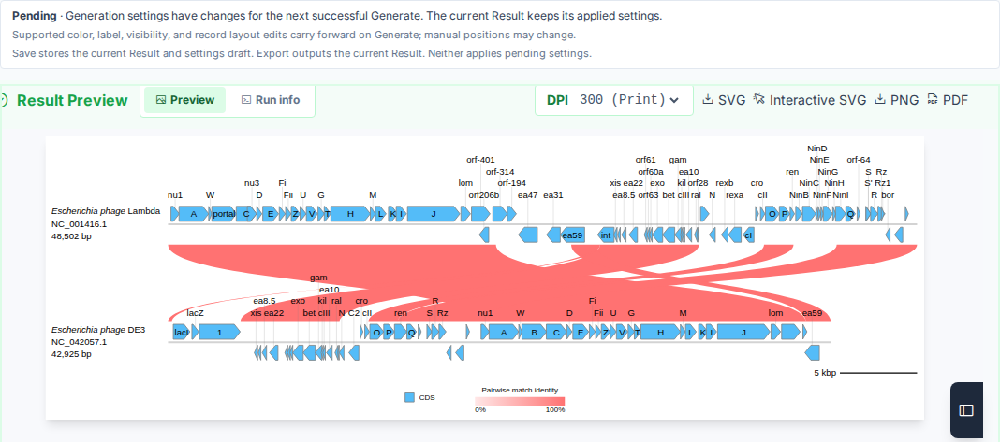
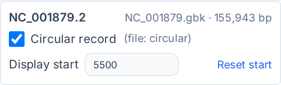
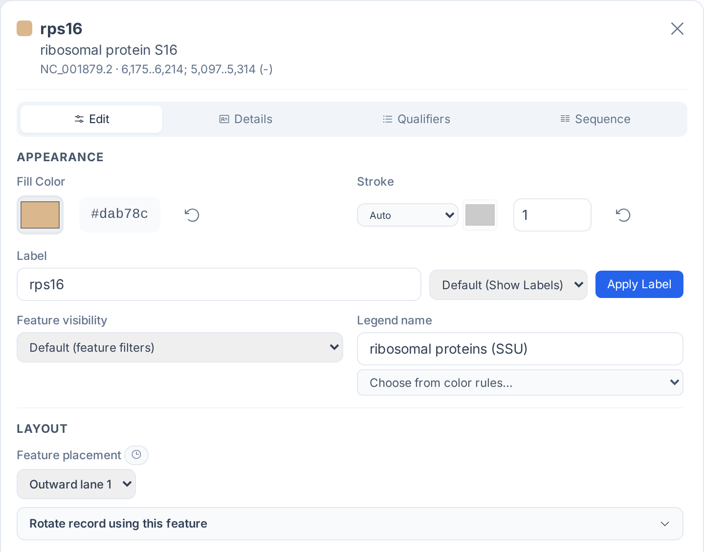

[Documentation home](../DOCS.md) | [Tutorials](../TUTORIALS/README.md) | [Technical documentation](README.md) | [FAQ](../FAQ.md) | [Gallery](../GALLERY.md)

# Web app

The hosted application at [gbdraw.app](https://gbdraw.app/) and local
`gbdraw gui` command expose the same single-page interface.

## Execution, privacy, and offline use

The hosted site downloads the application and its packaged runtimes from
`gbdraw.app`. After those assets load, the browser parses genome files, runs
LOSAT searches, renders diagrams, manages sessions, and exports files. These
operations do not require an application-server upload. The hosted site uses
Google Analytics 4 for aggregate page-usage metrics, but uploaded genome files
and generated diagrams are not analytics payloads.

The application keeps one choice in the browser's local storage: whether the
settings show in full or as the column of icons. The browser keeps it per
site address, so another browser, a private window, or another address starts
with the full settings. Files, settings, and Results are not stored there.
`gbdraw gui` serves the application at the same address on every run,
`http://localhost:24372`, so the choice lasts from one run to the next. When
another program uses that port, `gbdraw gui` says so and serves the
application on a free port instead. That is another address to the browser: a
choice made there is not kept, and copies left there are deleted only when
that port is used again.

When you choose an input file, the page writes its contents (a gzip file as
it is) to a temporary file in the browser's private storage for
the site, the origin private file system, and releases them from memory.
Generate, Save Session, and every later reading of the file read that copy, so
a file changed, moved, renamed, or deleted on disk after it was chosen
continues with the contents as chosen; choose the file again to use its new
contents. The copies sit on disk inside the browser profile, other sites
cannot read them, and they are never sent anywhere. The disk needs free space
for the inputs in use, including those an Undo step can bring back. A copy is
deleted when no drawing, History step, or running operation uses its file, and
when the page closes; copies left by a page or browser that ended abnormally
are deleted the next time the page opens at the same address, and a copy
another open tab uses is kept. A private (incognito) window keeps the copies in memory. When a copy
cannot be written (no free space, or the browser does not allow the storage),
the page reads the file itself, and a file that changed after it was chosen
then stops Generate or Save Session with "An input could not be read. Replace
or reselect it." (`INPUT_UNREADABLE`). Inputs read from a Session file are not
copied.

`gbdraw gui` serves the application and runtimes from the installed Python
package. Its normal drawing workflow works without an internet connection once
gbdraw is installed. Browser security policy still applies. Threaded LOSAT
also requires a cross-origin-isolated page. Select **Serial** under
**Execution** when that capability is unavailable; the **Threaded** choice then
reads **Threaded (unavailable here)**, and Generate with uncached LOSAT jobs
reports `LOSAT_THREADING_UNAVAILABLE` at the `losat` stage. **Threaded** reports the
same code when its threads cannot start or keep running in the browser, for example
when a thread does not start in time. **Auto** runs threaded
LOSAT wherever the page allows it, for every LOSAT program, and serial LOSAT on a page
without it or after a threaded job keeps failing. LOSATN task `dc-megablast` runs only
threaded: with **Serial**, or wherever **Auto** runs serial LOSAT, Generate stops before
the search and says so. Where threaded execution is
available, **Safe** is the conservative **Total threads** choice.

A saved session embeds input resources and should be protected like those
inputs. Browser extensions, proxies, the operating system, and downloaded
files remain outside gbdraw's privacy boundary. Runtime cost depends on record
length, feature density, record and comparison counts, search mode and
thresholds, memory, and CPU. There is no universal maximum genome size.
For a reproducible comparison, begin with **Serial** and one worker, then raise
concurrency only after measuring the same inputs. Large assemblies, dense
all-pairs searches, and large depth tables are better suited to a controlled
local environment or to prepared command-line runs.

## Modes and inputs

| Mode | Primary browser input | Result |
|---|---|---|
| Circular | One GenBank/GBFF container or one matched GFF3 + FASTA pair | One Circular result, separate results, or one multi-record canvas |
| Linear | Ordered GenBank rows or matched GFF3 + FASTA rows | One Linear result with an independent comparison plan |

Circular and Linear each keep their own settings and edits: the form and
advanced settings, palette and color rules, filters, Legend edits, feature and
label edits, Feature placements, annotation sets, Depth series, custom track
stacks, and the layout positions. A change made in one mode stays in that mode,
including a Generate; switching modes changes no setting and shows that mode's
settings and Result. **Reset Settings** resets both modes, and one **Undo**
restores both. The Circular inputs (the **Add files** zone and its File cards)
and the Linear **File** cards are separate inputs: a Circular
upload does not appear in Linear, and a mode switch keeps both. LOSAT run settings (run mode and threads) and the rich
feature popup are shared. A saved Session keeps each mode's settings
(Session 51, [compatibility](session-and-request-compatibility.md)).

Every file input also takes a gzip-compressed file (`.gb.gz`, `.fna.gz`,
`.gff.gz`, a gzip TSV): it is read as the plain file it holds, told by its
first two bytes, and a saved Session keeps the gzip file as it is
([input formats](input-formats-and-tsv-schemas.md#sequence-and-annotation-files)).
A gzip file that expands to more than 2 GiB (2,048 MiB) is refused with its
name as soon as it is chosen, and one in a loaded Session when you Generate;
choose its plain file instead.

A Circular GenBank upload starts in **Add GenBank/DDBJ files**, and its File
card then holds the file in **GenBank/DDBJ File**. Each Linear **File** card
starts with its **GenBank / DDBJ File** uploader, or its matched GFF3 and FASTA
uploaders, followed by its name fields and a closed **Record options**
disclosure. The card shows one names block. A File with one record shows that
record's own **Organism / strain** and **Subtitle / title** on the card. A File
with two or more records, or a one-record File that holds a File-level name
(for example from a loaded Session), shows **Names for all records in this
file**, and each record keeps its own name fields in its **Record options**.
Clearing the File-level name of a one-record File puts the record's fields on
the card once the focus leaves the block. A record draws its own value, else
the File value, else the inferred definition. Use the up and down buttons in a
File header to
move that source. Every record in a multi-record GenBank or GFF3 + FASTA source
moves together, while the record order inside the source stays unchanged. When
each File uses its own consecutive rows, the File moves as one block of rows and
the row positions follow the new File order. If Files share a row or another
File's row separates a File's rows, File movement is unavailable; use **Record
Layout** to edit or normalize that custom placement first.
Uploading a GenBank file gives each of its records a **Definition** inferred
from that record's own `/organism` and `/strain` qualifiers, so a File of
several organisms shows each organism's name. The **Organism / strain** and
**Subtitle / title** fields stay yours to fill: a subtitle names one replicon
rather than the whole file. A name typed on an empty card is kept when its
file is chosen: it stays the record's name for a one-record file and becomes
the File-level name for a file with several records. The prominent
**Add sequence** action appears below the Linear File list. A GenBank file may
contain several biological records. GFF3 input requires the matching FASTA
sequence and exact sequence-ID agreement. See [Input formats and TSV
schemas](input-formats-and-tsv-schemas.md) for the file format.

The **Add sequence** action and the **Remove** action shown for multiple Files
add or remove whole File cards. Clearing a populated Linear primary uploader
opens a choice: **Empty this slot** keeps a pristine blank File in the same
position, while **Remove file**
removes that File and all records it supplied. Either operation removes its
record selectors, crop and reverse-complement drafts, labels, Depth file assignments,
comparison endpoints, and source-derived state as one undoable change. The only
File cannot be deleted. Removing an empty final File is immediate; removing a
populated final File asks for confirmation. Cancel and Escape change nothing.

The header line of a Linear File card, which starts with **File N**, folds the
card to that one line and opens it again: click the line, or focus it and press
Enter or Space. A press on a move button moves the card and does not fold it. A
folded card shows its file name after **File N** (both names for GFF3 + FASTA,
"No file" for an empty card). When one file of a GFF3 + FASTA pair is missing,
the line names it, for example "genome.gff3 + no FASTA", without the green
check. A file that could not be read is shown in red with a warning icon, and
**Gencode required** is shown when a record needs a translation table. After
**Load Session** or **Load example** the cards that hold their file, or both
files of a pair, are folded; a card with a file still missing stays open, a card
you add stays open, and choosing a file does not fold it. Which cards are folded
is not saved in a Session and is not an Undo step: Undo and Redo leave every
card as it is, and a File that Undo brings back after **Remove file** returns
folded if it was folded.

Replacing a File with one that holds several records expands it into one row
per record. The new rows keep only File-level values (the File, its Depth TSV,
and the file defaults); the crop, reverse complement, **Definition**, and
**Subtitle** of the replaced File's row do not carry over. Replacing a single-record
File with another single-record File keeps them.

Each Linear File card starts with its **Depth TSV** disclosure closed. Its
summary line reports how many Depth tracks the File has attached, for example
"No depth track attached". Click the summary, or focus it and press Enter or
Space, to open the disclosure; the open state is not saved. Inside, each logical
series reports whether its file is attached to all, some, or none of the File's
records. Use **Add Depth TSV series** there to add one logical series
for every record while preserving existing assignments. A new series has no file,
so it adds no track row; see [Custom Track Slots](#custom-track-slots).

## Main workflow

1. Choose the **Circular** drawing or the **Linear** tab in the drawing bar.
2. Add the biological inputs and resolve any validation message.
3. Set layout, tracks, comparisons, labels, and output values.
4. Select **Generate Diagram**.
5. Inspect **Result Preview**, then export a file or select **Save Session**.

**New drawing from a region…** in the drawing menu (the menu of a drawing tab,
beside **New Circular drawing** and **New Linear drawing**) draws chosen regions
of the shown drawing as a new drawing. The dialog lists the drawing's records.
For each, **Region** is **Whole record**, **Coordinates** (**Start** and **End**,
1-based and inclusive, in the source's coordinates), or **A feature** (choose it
under **Feature**). **A feature** is disabled with a reason until the drawing
has a Result, and for a record without features. One whole record keeps the
drawing's mode; any other choice makes a Linear drawing. A start after the end
is refused. The dialog lists the sizes that return to Auto for the new length
and what is not carried; **Keep my values** keeps the sizes you set. **Create**
adds the drawing as a new tab, and one Undo removes it. Python offers the same
through `derive_region_drawing()`; see [Typed requests](./typed-requests.md).

### Drawings

One Session holds one or more drawings. The drawing bar under the header has
one tab per drawing. A new Session starts with one Circular drawing and, after
its tab, a Linear tab with a plus icon that adds an empty Linear drawing.
You can keep several drawings of the same mode, for example a whole-genome
Circular drawing and a Circular drawing of a gene cluster from the same input.
Selecting a tab shows that drawing. It changes no value, is no Undo step, and
is unavailable while a diagram is generating or a Session is being saved or
loaded.

The menu of the shown drawing's tab holds:

- **New Circular drawing** and **New Linear drawing**: an empty drawing with
  that mode's defaults and no files.
- **New drawing from a region…**: see above.
- **Duplicate drawing**: copies the files, settings, legend and feature edits,
  and Result; the copy starts with an empty History.
- **New Circular drawing with this style** and **New Linear drawing with this
  style**: copies the settings and style but no files, legend edits, per-feature
  edits, **Feature placement**, annotation sets, bulk label edits, or group
  names. Of the **Default colors**, **Specific rules**, **Blacklist**,
  **Whitelist**, and **Priority** tables it copies the rows you typed, not rows
  loaded from a file. Into the other mode it copies only the settings both modes
  have.
- **Rename…**, **Move left**, and **Move right**: rename the drawing and change
  its tab order.
- **Delete drawing**: the last drawing cannot be deleted. A drawing with a
  Result or edits asks first (**Delete drawing** or **Keep drawing**), and Undo
  restores it with its settings, edits, Result, and History. The shown drawing
  gives way to the next tab, or the previous tab when there is no next one.

A drawing's mode is fixed when you make it. Each drawing keeps its own
settings, palette and color rules, label tables, legend and feature edits,
selected records and regions, Depth assignments, Result, and History. A change,
**Generate Diagram**, a failure, or Undo in one drawing does not change another
drawing's settings, legend, History, or Result. Drawings share the content of
the input files, the Session title, and the settings that are not part of a
drawing: **Auto Reflow**, PNG DPI, palette **Instant Preview**, **Rich Feature
Popup**, and the LOSAT run method and thread count. Export and **Save Session** use the shown
drawing's current Result and values.

The same file content is stored once per Session. A drawing can pick a file
that is already in the Session from the uploaders, without uploading it again.
When you upload over a file that another drawing also uses, the app asks
**This drawing only** or **Every drawing that uses this file**. The first
changes only the card you uploaded over. The second also swaps the file, keeping
each card's state, in the other cards and drawings that use it. The five
table files (**Default colors**, **Specific rules**, **Blacklist**,
**Whitelist**, and **Priority**) always change the shown drawing only and do
not ask. A file that no drawing uses any more is not saved.

**Undo** and **Redo** walk the shown drawing's steps together with the steps
that belong to the whole Session, newest first, and never undo another
drawing's steps. Session steps are adding, duplicating, renaming, moving, and
deleting a drawing, **Reset all drawings**, replacing a file for **Every drawing
that uses this file**, and changing a Session-wide value such as the Session
title or **Auto Reflow**.

**Reset Settings** asks for a choice: **Reset this drawing**, **Reset all
drawings**, or **Cancel**. **Reset this drawing** returns the shown drawing's
settings and edits to their defaults and leaves the Session-wide values as they
are. **Reset all drawings** does that for every drawing and also returns the
Session-wide values to their defaults. Reset edits (colors, strokes, hidden
features, legend, labels) reach the shown figure at once; reset settings that
apply on Generate change at the next **Generate Diagram**; a drawing that is not
shown takes its reset when it is shown next. Either choice keeps the input
files, the record selection, file defaults, Depth assignments, and Result, and
one Undo reverses it. A kept Depth file stays hidden (**Show Depth** turns off)
until you show it again, and the legend names its series after the file, as an
upload does. A kept Circular comparison file (a comparison sequence file or a
BLAST table) keeps its ring row with the row's settings back to their defaults,
and the rings stay hidden (**Show Comparison Rings** turns off) until you show
them again; the ring results of an earlier LOSAT search are dropped, so the
next Generate after you show the rings searches again. **Cancel** changes
nothing and records no step.

The table below states when each kind of edit reaches the Result. A clock
icon beside a setting's heading or label marks a change that applies on
Generate, wholly or in part. Its tooltip, which opens on hover, keyboard focus,
or a tap, reads **Applies on Generate** or names the parts that apply at once.
A setting without the icon changes the Result at once. Settings that apply on
Generate stay in the settings draft until the next successful **Generate
Diagram**; until then the Result keeps its applied settings. The app does not
show a separate always-on application status.

| Kind of edit | When the Result changes |
|---|---|
| **Applies on Generate** (clock icon) | Every setting the Result draws that is not a live edit or **Apply required**, including **Feature placement** in the feature popup and the selection toolbar, and **Default colors** while a palette change waits. The clock sits in the heading of each such card or group. Adding a Depth file, or a Depth series while a Depth file is loaded, turns **Show Depth** on, and removing the last Depth file or the File that holds it turns it off; turning it off hides the drawn Depth track at once, and a Depth track from changed files appears on Generate. In a custom stack, adding, moving, or changing a row applies on Generate. Changing a Depth **Legend title** clears a Legend tab rename of the old title at once; the new title appears on Generate. **Output Prefix** names the Results of the next Generate, and exports take their file names from the Result. **Embed font in exported SVG** affects exported SVG files only, and **White background** affects PNG downloads only. |
| Live edit (no mark) | Feature color, label text, and visibility, including **Feature Visibility** rules, update the current Result directly (leaving a feature out of protein search applies on Generate); an edit that adds or removes geometry rerenders the Result automatically. A label rerender uses the settings of the last Generate plus the current feature, label, color, and legend edits, and the live setting values changed since. Legend text, order, stroke, and removal, and stroke edits on selected features, are live. Palette selection is live when **Instant Preview** is on. The Legend card (position, swatch size, font size), the plot title (**Plot Title**, its position, and its font size), the definition text (**Species**, **Default font size**, and the Linear definition row **Size**, **Weight**, and **Color**; not **Strain**, or **Keep Full Definition**), record names (**Organism / strain** of a Linear File or record, and **Record label** and **Subtitle** of a Circular record; the record popup shows each field's note), the **Dinucleotide content/skew** **Window**, Region Annotation **Fill color** and **Line color**, Comparison **Match height**, **Center Reserved Radius**, and the custom-stack row **Height** in Linear, the Circular multi-record canvas layout (while the Result is a multi-record canvas; otherwise it applies on Generate and says so), and the Linear **Lock Definition Column** rerender the current Result automatically (in Circular, while a **Multi-Record Canvas** change waits for Generate, the Legend and Plot Title positions apply on Generate, and the notes say so; turning **Multi-Record Canvas** back to the shown canvas applies them) from the settings of the last Generate plus the changed values; if the rerender fails, the Result and the last Generate's settings stay, the control keeps its value, and **Live edit failed** appears. Region Annotation colors and a Linear row **Height** have a note per item: an item with a Legend label, an item added since the last Generate, and a features or Depth row say **Applies on Generate**. Record names say **Applies on Generate** when the Result is a Circular batch or grid, or when a Linear File card was moved, removed, or replaced, or its record changed, since the last Generate. **Show GC Content**, **Show GC Skew**, and **Show Depth** (Linear), **Hide GC Content**, **Hide GC Skew**, and **Show Depth** (Circular), turning a GC content, GC skew, or Depth row of the custom stack on or off or removing it, and **Use custom stack** rerender the current Result the same way: a track comes back as the last Generate built it, and other changed values of its row (a width, a color, the track type) still apply on Generate. An Overlay row that left with the track it names comes back the same way when the stack draws both again: by Undo, by turning it back on by hand while the track is back, or by turning **Use custom stack** back. Showing a track applies on Generate if the Result did not draw it when its Session was loaded (a track hidden at once after the load comes back at once); after a Depth file or series change, or a change of the records the Depth files map to; for a custom stack row added since the last Generate or a stack the last Generate could not build; and, with a Circular custom track stack or Circular track widths or radii, for **Hide GC Content** and **Hide GC Skew** turned off by hand (an Undo of that hide applies at once, with the rows it turned off). **Use custom stack** applies on Generate, with every track it would hide or show, when it is turned on after a Session load, and when it is set the other way than the Result was drawn while the Region Annotation sets differ from those the Result draws; turning it off after a Session load on a Linear Result drawn with the stack applies at once. A Circular Result drawn with a custom stack or with track widths or radii does not show which way it was drawn. After a Session load, **Use custom stack** set the other way than the Session saved it applies on Generate, with every track it would hide or show; while it stays as saved, the stack stays as it is and only the tracks a setting hides leave at once. Hiding a track always applies at once. Turning off or removing a custom stack row, **Hide GC Content** or **Hide GC Skew** when it turns off a stack row, removing a Depth series, removing a series' last Depth file (**Remove Depth TSV**, **Remove from all records**, or a record's own uploader), removing or clearing a Linear File that holds such a last file (from its card or with **Remove File** in the record list, after that question), and removing or replacing a source in Circular **Pairwise Comparisons** while **Use custom stack** is on and its ring row leaves with it, when another row starts at or extends to that track (an Overlay row's anchor or **Extend to**), ask first, with **Use custom stack** on or off for every change but the last: the dialog names those rows ("Track row N" and the row's ID) and offers to make the change and turn those rows off as one Undo step, or Cancel, which changes nothing (the file, series, or row stays). A Depth row with a width, spacing, or ID you set stays in the stack when its last file goes: when another row reaches it, the dialog says so and the choice turns it off too; when no row does, nothing asks and Generate reports the row issue. With two or more series, when another series keeps a file and Generate still draws Depth (**Show Depth** on, or with **Use custom stack** on a Depth row still on), the dialog also says the series stays empty and Generate will ask for a file or its removal; the series stays, and Generate refuses until it has one or is removed. While **Use custom stack** is on, **Hide GC Content** and **Hide GC Skew** ask also when no other row does. A Depth row with no width, spacing, or ID you set leaves with its last file, also after a Generate and in a saved Session, and Generate draws: a moved row leaves too, and a file added again puts it at the default place; a Linear row's **Height** is also its series' height, which stays, and a file added again draws at it; a row you turned off stays, off, and stays off when a file is added again. With no row reaching it, such a removal takes the Depth row out at once, and nothing asks. On a Result loaded from a Session saved without a render request (Session versions 27 to 30), the settings above that rerender the Result apply on Generate and say so; the edits that update the Result directly (such as feature color, Legend, and palette edits) stay live. |
| **Apply required** | Alignment choices stay in the review draft until **Apply** succeeds. |

A live edit can succeed while other settings stay in the draft. **Live edit
applying** and **Live edit failed** appear above the Result while a live
rerender runs or after it fails. A rerender failure keeps any direct edit already applied and keeps the previous
diagram geometry. **Live edit failed** names the cause. It suggests retrying the live edit only
when the same request can succeed, such as after a background-process failure.
Otherwise, change the edit, or change the settings and select **Generate
Diagram**. An unapplied alignment
review is a local selection, not an applied Result or a generation-setting change.

**Generate Diagram** recalculates placement and resets zoom. Supported color,
label, visibility, legend text and order, canvas padding, and record-layout
edits are carried forward. Generate places legend entries in the edited order
on its new layout; an entry that appears later follows them. Generate may not
draw a legend row, such as GC content while it is off or a Depth row while
**Show Depth** is off. If you rename such a row, the new name waits with the
colors and applies when a later Generate draws the row. Removing the row's data
also discards the waiting name and colors. Canvas padding
applies once to every Result, including each Result of a batch. For the same
diagram, a manually moved legend, plot title, or Linear scale keeps its offset
from the newly calculated position. The absolute position can change when
settings change. Other manual positions have no new regeneration guarantee.
**Undo** restores the previous Result. Failed, canceled, or superseded
generation keeps the last successful Result. While a diagram is generating,
**Undo** and **Redo** and their keyboard shortcuts are unavailable, and the
header names the reason; settings edits stay available and are recorded.
Undo history has a memory limit. When a large diagram reaches it, the oldest
steps are discarded and a notice says so; the step just taken stays undoable.

**Save Session** saves the current Result and supported settings draft together.
**Load Session** displays that saved Result without applying a newer draft.
**SVG**, **PNG**, and **PDF** export the current Result. Save and Export do not
Generate or apply draft settings. A review's guide, candidate numbers, and
unapplied choices are not included in saved or exported files.

For Linear diagrams, the sections appear on screen and in keyboard order as
**Input Genomes**, **Comparison**, **Basic**, then **Advanced comparison and
layout**. In both
modes, **Generate Diagram** is the last keyboard stop of the settings panel,
after every section, and its bar stays fixed at the bottom of the panel.

A row of icon buttons above the settings lists the sections of the current
mode in the same order, without **Basic** and **About & Citation**. A button
opens its section, brings it to the top of the settings, or as far as the
settings scroll when the section is near the end, and moves the keyboard focus
to its heading; it never closes a section and changes no setting. The section
title appears below a button on hover and on keyboard focus, and a screen
reader announces the button as "Go to" followed by that title. The button of
the section at the top of the settings is marked. The row stays in place while
the settings scroll; a narrow panel wraps it onto a second line, and at phone
width it is the first row of the settings and scrolls with the page.

**Collapse settings to icons**, the button at the right end of the row, turns
the settings into a narrow column of the same buttons, each an icon over a
short name, with **About & Citation** at its end. A button of the column shows
its section beside it, one at a time: **Input** shows **Input Genomes** and
**Basic**, and in Linear mode **Compare** shows **Comparison** alone. **Close
section** leaves the column alone, which gives the Result the most room, and
**Expand settings**, the first button of the column, brings the full settings
back at the same place. Every setting keeps its value through these switches;
they are not Undo steps and are not saved in a Session. A link that leads to a
setting, such as **Show in Comparison** or **Show in settings**, shows the
section of that setting first. Beside the column alone the Generate button
reads **Generate**. A column taller than the window scrolls. At phone width the
settings always show in full.

### Save and Load Sessions

**Save Session** asks for a **Session title** in a dialog when none is set
(Enter saves, Escape cancels) and downloads
`<title>.gbdraw`. The title beside **Session** in the header
opens the same dialog as **Rename Session**. Saving again under the same file name first
asks whether to **Download again**. When the Session file is larger
than 50 MiB, Save names its size and asks before it downloads. **Cancel** in
either dialog saves nothing. When the download starts, a notice above the Result
names the file. **Load Session** accepts `.gbdraw` and `.zip` Session files
and older `.gbdraw-session.json` and `.gbdraw-session.json.gz` files (`.json`,
`.gz`); after a load, the notice names the loaded file
and lists any warnings about older Session content. Dismiss the notice with its
close button; the next notice replaces it. Generate keeps it, since it describes
the loaded Session; **Reset Settings** and a switch between Circular and Linear
clear it. Popups open below the notice while it is in the upper half of the window, so it stays readable. On gbdraw.app, **Load example** in the header
and **Open Gallery example** in the empty Preview list the Gallery examples and load
the chosen one's Session, asking first when the current work has unsaved
changes. The local `gbdraw gui` ships no Gallery and shows neither button. On gbdraw.app the empty Preview also shows a **Learn with tutorials** button under **Open Gallery example**,
each row of the example list has a **Tutorial** link, and the notice of an
example loaded with **Load example** links to that example's tutorial; each
opens the Interactive Gallery's tutorial, which is in English, in a new tab.
**Gallery & tutorials** in the header opens the Interactive Gallery at
gbdraw.app in every build, the local `gbdraw gui` included. Where the one-row
header lacks room, the button shows only its icon, and where even that would
narrow the Session title, **Reset Settings**, **Save Session**, **Load
Session**, and **Load example** show only their icons too and the header's
groups move closer together; where the title would still narrow, the
**Session** caption before it is hidden, and then the closed **Language** menu
is only as wide as the shown language's name (in browsers with CSS
`field-sizing`, such as Chrome and Edge). Where the Session title would still be
narrower than 5rem (80 px), the header takes the two-row layout it has in a
window 768 px wide or narrower. In the two-row header, the button shows only
its icon, at the end of the logo's row.

While **Saving session…** or **Loading session…** is shown, the operation works
on one consistent document. **Generate Diagram**, file inputs, mode, settings,
editor changes, **Undo**, **Redo**, **Reset Settings**, and the other Session
button stay unavailable until it finishes. You can still scroll the settings,
pan and zoom the Preview, and type in feature search. A second **Save Session**
click during a save does not download a second file. While a diagram is
generating or updating, **Save Session** and **Load Session** are unavailable,
and the header names the reason, such as **Generating diagram. Retry after
generation finishes.**

A `.gbdraw` Session file has no limit on the size of its inputs; only its
settings and results (`gbdraw-session.json`) are limited to 512 MiB, on Save and
on Load. Load first checks that the browser has room to store the inputs, and
Save refuses when the browser has no room for the file; each refusal names the
sizes. An older JSON Session file larger than 200 MiB, or a gzip one that
expands beyond 512 MiB, is rejected. Load needs Web Workers and, for `.gz`
files, gzip decompression. A rejected or failed Save or
Load shows its error and keeps the current Result, settings, and Undo history.
A failed Load shows its reason and correction under **Session not loaded**,
unless a more specific step names the error: for example, that the file is not
valid JSON, or that Custom Track Slots must be recreated with the current
schema. An error of one diagram mode is cleared
when you switch to the other mode, except an error that names the other mode's
Result.

Before the first **Generate Diagram**, Save needs every input of the active
mode, the same check that Generate uses; an empty card or a missing FASTA is
reported by its **Sequence** number. A Result loaded from a Session saved before
Session 40 has no current feature metadata: a notice above the Result says so,
and **Save Session** reports that one Generate is needed and offers **Generate**.
After that Generate, Save writes the current Session format.

**Save Session** writes every drawing in one Session file, with the drawing
you are viewing; a drawing with no file, no changed setting, no edit, and no
Result is not written (if none would be, the shown drawing is written). Each
drawing keeps its own settings, edits, and saved Result. **Load Session**
restores all drawings at once or changes nothing, shows each drawing's saved
Result without generating it, and opens the drawing that was shown at Save. If
that drawing was not written, it opens the next tab, or the previous tab when
there is no next one. Sessions are saved as Session version 51, which gbdraw
0.14.x cannot open. Sessions saved by 0.14.x (versions 46 to 50) open as before,
each into its drawings.

A loaded Circular Session shows its saved Result without reading the embedded
source again. **Source records** shows **Records not inspected**, and **Record**
says **Not inspected**. Select **Inspect source records** to list them and show their
rotation rows; the Result and Undo history do not change. **Generate Diagram**
inspects the source before rendering, and uploading a new file inspects it at
once. Loading a saved preview does not start LOSATP. The diagram engine starts
during Load only to validate saved settings that have no web control, such as
the configuration that a command-line Session stores.

### Operation errors and diagnostics

A failed operation shows a short cause and correction or recovery action under
its own heading, such as **Generation Error**, **Alignment error**, **Session
not loaded**, or an export error. When Generate fails, the error says once that
the last successful Result is shown and the changes were not applied. A Linear
comparison error offers **Show in Comparison**, which focuses the control of
the first issue. The summary stays visible. **Details** is optional and initially closed;
it can be opened with the keyboard. An error shown beside its own field, such
as an invalid Color rule pattern, is compact: the summary under the field and a
small **Details** disclosure with the same diagnostics and buttons, followed by
the field's **Retry** and **Revert**. **Copy diagnostics** copies only the safe
information displayed there, after an explicit action. If Clipboard access is
unavailable or rejected, **Select diagnostics** selects the text for manual
copying; the cause and recovery controls stay available.

Diagnostics contain a short failure code, the operation, the stage where the
failure is known to have happened, and allowed context such as the field, table
row, or character position. They also report any failure while cleaning
up. The summary names the location it knows: **Sequence N**,
**Line N**, **Track row N**, **Depth series N**, the setting path, or the
available radial band in px for a Circular track that does not fit. The panel
offers only actions that work there: **Generate** when a fresh Result is the
correction, and no **Save Session** when Save itself failed. For an unknown failure, the panel shows a failure code and the stage where it
happened, and it does not guess a cause. A failure in the diagram engine's drawing stage
that no validation classifies names the Python exception class (for example
`ValueError`) and offers **Save Session** instead of **Retry Generate**, because
the same inputs fail the same way. A comparison search that LOSAT stops with its
own message, shown after **LOSAT reported:**, or that serial LOSAT stops
unexpectedly, offers no **Retry Generate** either: **Show in Comparison** opens the
LOSAT mode in the Comparison settings of a Linear diagram, and **Pairwise
Comparisons** in a Circular diagram. When threaded LOSAT stops unexpectedly even
after running the search again, the panel names **Serial** and **Auto** and keeps
**Retry Generate**. A diagram that was drawn but is too large for
the browser page to receive also offers **Save Session** and no **Retry
Generate**: draw a smaller region, turn off tracks or labels you do not need, or
draw it from the saved Session with `gbdraw circular --session` or
`gbdraw linear --session`. Original patterns, sequences, file or record
names, paths, SVG, raw exception text, traceback, stdout and stderr are excluded
from diagnostics and automatic console output. A saved Session can contain
private inputs, so share one only deliberately.

After a successful Generate, a record of the shown Result with no feature to
draw, a comparison table whose rows the thresholds all leave out, or a Region
Annotation set that the custom stack (**Use custom stack**) has no Annotations
row for shows **Part of the input was not drawn.** under the status line, with the same
warning the command line prints (see [Input
summary](command-line.md#input-summary)). A similarity ring's comparison file
whose record IDs repeat shows its warning there too, without that heading: the
ring draws every record. When the warnings that leave input out, or those of an input drawn in full,
number more than four, the notice shows their first three and a line such as
**and 53 more**, which opens the rest in a box that scrolls. **Run Info** lists the shown Result's
**Input summary**: what it read and drew, per record and per comparison table.
Neither is saved in a Session; the next Generate recomputes them.

While Generate runs, the status line names its stage. The first Generate of a
page also prepares the diagram runtime and shows each preparation step as it
starts, for example **Preparing diagram runtime (first use): step 4 of 5,
installing packages...**; it is a step count, not a time estimate.

After a failed Generate, the message tells you which case applies: no successful
Result yet, the previous Result unchanged, the rollback completed, or the
rollback failed. After a failed rollback, the message does not claim that the
previous state was restored. Canceling an operation, replacing it with a newer one, or receiving a late
answer from an old one shows no new failure and does not apply the old result. Align failures keep the review choices and the last successful Result, so you can correct the choices and select **Apply** again.

### Font

**Font** is its own section after Layout. It sets the font of all diagram text.
Circular and Linear each have their own setting, which applies on Generate and
follows Undo, Redo, and **Reset Settings** like other settings. It offers
**Liberation Sans (default)**, **Liberation Serif**, **Liberation Mono**, the
fonts loaded in this page, **Load font file…** (`.ttf`, `.otf`), and, only in
Chrome and Edge, **Choose installed font…** (the browser asks permission; search
by name). A loaded font lasts until the page is closed. gbdraw measures labels,
the legend, and titles with the chosen font, and the preview shows it.

For a custom font, a note says that a saved Session keeps only its name, and the
**Save Session** notice repeats it. The checkbox **Embed font in exported SVG**
appears when the selected font or the font of the shown result is a custom
font. It is on by default, is a page setting that is not saved in Sessions, and
is not an Undo step. It applies to SVG and Interactive SVG exports, not to
Generate. PNG export always draws the font, and PDF export embeds it whatever
the checkbox, except a font whose license forbids it, which the PDF draws in the
nearest Liberation font. See [Fonts](output-formats-and-export.md#fonts) for what each
format contains and the export notices, and
[Session fonts](session-and-request-compatibility.md#fonts) for loading a
Session whose font is not available.

### Label Line and Label Protection

**Label Line** (**None**, **Underline**) and **Label Protection** (**None**,
**Halo**, **Box**) follow **Label Rendering** under **Labels**. They set how a
feature label with a leader line is drawn, as `--label_line` and
`--label_protection` do on the
[command line](command-line.md#tracks-annotations-and-presentation). Circular
and Linear each have their own pair (Linear **Underline** and **Box**, Circular
**None** and **None** by default; **Halo** can be chosen), which applies on Generate and is saved in
Sessions. **Underline** is drawn under horizontal labels only; a turned label
gets no line, and its leader ends at the letters. **Box** is a white box at 80 % opacity behind the letters; in Linear a turned
**Above Feature** label on its feature gets one too. When **Halo** is chosen, the PDF
export draws labels without their halos; SVG, Interactive SVG and PNG keep
them. A box is drawn in every format.

**Italic gene names**, after **Label Protection**, draws in italics each label
that the label priority takes from the `gene` qualifier, as
`--italic_gene_labels` does. A label stays italic after its text is edited in
the feature popup or a label table; other labels stay upright. Circular and
Linear each keep their own setting, off by default, which applies on Generate
and is saved in Sessions.

### Numeric settings

Generate sends every numeric setting as you typed it. An empty field means Auto
or the documented default. A number is passed unchanged, so the diagram engine
either accepts it or reports the field and the accepted range, as the command
line does. Text that is not a number is rejected with the field name. Generate never
rewrites a setting; after a failure the field still shows the rejected value.
Comparison thresholds (**E-value**, **Bitscore**, **Identity**, **Alignment
length**) are checked before LOSAT runs against the same accepted ranges.

### Depth and GC Percent axis labels

A depth axis and a GC content axis in **Percent** mode print one range label,
such as `[0–80x]` or `[10–55%]`, and draw every tick mark without a number.
**Numbered Ticks** (in **Depth TSV tracks** and in **Dinucleotide
content/skew**) prints a number on each large tick instead; a number that
would overlap another is left out. The setting applies on Generate and is
saved with the drawing. A Session saved before the setting existed loads with
**Numbered Ticks** on, as it was drawn. On the command line the same settings
are `--depth_axis_labels` and `--gc_content_axis_labels`.

### Circular track Width and Radius

In **Layout → Custom Track Slots**, **Width** and **Radius** each have a
numeric text field and a **px** / **×R** selector. R is the base circle radius;
`0.65 ×R` means 65% of that radius. Existing `65%` values display as `0.65`
with **×R** selected. Complete `20px` or `65%` input is also accepted and
separated into its numeric value and unit. Reading a saved value does not
rewrite it. Decimal and exponent input keep their precision and are not rounded for display.

A plain number uses the selected unit: `1.5` with **px** means 1.5 pixels,
while `1.5` with **×R** means 1.5 times R. Changing the selector keeps the
number and changes its meaning; it does not convert the physical size.
Manual numeric and unit edits support **Undo** and **Redo**. Effective changes
reach the diagram on the next successful **Generate Diagram**. Export
continues to use the current Result.

Clear the numeric field for **Auto**. Its resolved geometry appears separately
with units. While the field is empty, the selector chooses the next input's
unit only; it does not change Auto geometry, create a History step, or enter
the Session. That preference starts at **×R** and resets when the panel is
remounted or settings are loaded or reset. History restores a manual value
and its unit, or Auto's empty value; it does not promise to restore Auto's
next-input preference.

Incomplete or invalid input stays visible with its selected unit and a field
error. Zero, negative values, nonfinite values and unsupported units are
invalid, not Auto. A failed Generate keeps the previous committed request
and Result; correct the field and Generate again. A valid Session saves the
editing draft separately from the committed Result, including disabled and
inactive track values. Loading it shows the saved preview; Generate applies
the restored draft. Invalid drafts cannot be saved as valid Sessions.

### Custom Track Slots

The arrow buttons of a row move it within its side of the Axis. Its **Row
actions** menu holds the moves across the Axis (**Move outside Axis** and
**Move inside Axis** in Circular, **Move above Axis** and **Move below Axis** in
Linear), **Track on Axis** for a row that can sit on the Axis, **Duplicate**,
and **Remove** (Circular) or **Delete** (Linear). The arrow keys move through
the menu and Escape closes it.

An annotation row placed on its anchor (**Overlay anchor** in Circular, **On
axis** in Linear) has an **Extend to** list: choose a second slot to stretch the
overlay from its anchor to that slot (`to_slot`, see
[Region annotations](../CLI_Reference.md#region-annotations)), or **None**. The
list offers the anchor's slots except the anchor itself, and the setting applies
on Generate. Moving the row off its anchor or changing its renderer clears it.
The editor has no `z` field: placing the row on its anchor, or changing its
layer (**Underlay** or **Foreground**), anchor or **Extend to**, gives it a `z`
one below the lowest (**Underlay**) or one above the highest (**Foreground**)
`z` of the slots it names, and keeps a `z` that already meets that rule, such as one from a loaded
Session.

Each Circular row keeps its inner and outer gap in a disclosure under the row;
for a GC or AT content or skew row it also holds the dinucleotide, the legend
label and, for skew, the two colors. Its summary names the dinucleotide and says
when a gap or a skew color is set.

**Use custom stack** draws the saved stack. Turning it on or off redraws the
current Result at once with the stack the last Generate built (see **Live
edit**). Turning it on for the first time uses the saved default stack as it
is, including its **Ticks** row. **Reset**
and, in Circular, the **Tuckin**, **Middle**, or **Spreadout** button under
**Reset to preset** rebuild the stack from **Show Coordinate Scale**,
**Hide GC Content**, **Hide GC Skew**, and the loaded Depth series.
Turning the stack on, and **Reset**, also give each Region Annotation set
that no row names its Annotations rows at the top of the stack, where the
figure draws the set without a stack: a row for its lines, brackets, and
bands, and an Overlay row behind the feature track for its highlights. The
figure then stays as it was. A sequence search's set gets no row; it is drawn
as before.

Depth rows follow Depth files the same way in Circular and Linear. When a
logical Depth series gets its first file, the stack gains one Depth row for it,
unless a row, enabled or disabled, already references that series. When the
series loses its last file, the rows that are on and still have their default
settings are removed, also when you moved them; a row you turned off stays, off.
This happens whether or not the custom stack is in use. Other settings never add,
re-enable, or move a Depth row, so a row you removed, disabled, or moved stays as
you left it. **Add Depth TSV series** and a series **Remove**
add no row.

An enabled Depth row whose series has no file, for example a row with a width,
spacing, or ID you set after a Linear File's Depth TSV is cleared, shows "Depth track '<id>' has no logical Depth
source." **Generate Diagram** then stops on that row. Add a file, or disable or
remove the row. A Session whose inactive custom stack has no Depth row does not
gain one when you turn the stack on; use **Reset**.

**Hide GC Content** and **Hide GC Skew** disable the matching enabled rows
that use the **Dinucleotide** setting, whether or not the custom stack is in
use, and turning the option off enables those rows again. A row with another
dinucleotide, such as an AT skew row, is not affected. Rows you disabled yourself stay disabled. Turning off or removing a row that an enabled Overlay row starts at or extends to asks first and offers to turn that row off too, whether or not the custom stack is in use: with the row's switch, its **Remove** or **Delete**, **Hide GC Content** or **Hide GC Skew**, the removal of a Depth series or of its last Depth file, and the removal or clearing of a Linear File that holds that file. In use, the removal of a comparison source whose ring row leaves with it asks too. A row's resolved
**(auto)** geometry comes from the last generated diagram and appears only for
rows it drew. Any other row, and every row before the first Generate, shows the
Auto **Width** and gaps it asks for as an estimate written as "≈ … (estimate)",
and its **Radius** as "Auto": the layout places the row, and may narrow its
width when the rows do not fit, only when Generate draws it. An **Overlay anchor** annotation row
that no diagram has drawn yet names the rows it follows instead, such as
"follows features → gc_content" (Circular **Width** and **Radius**, Linear
height). A ticks row's **Radius** note is the tick
anchor, the radius that a typed **Radius** pins, not the centre of its band.

### Follow a Result and its settings draft

For a small Linear comparison, download the complete GenBank records
[Lambda (NC_001416.1)](https://eutils.ncbi.nlm.nih.gov/entrez/eutils/efetch.fcgi?db=nuccore&id=NC_001416.1&rettype=gbwithparts&retmode=text)
and [DE3 (NC_042057.1)](https://eutils.ncbi.nlm.nih.gov/entrez/eutils/efetch.fcgi?db=nuccore&id=NC_042057.1&rettype=gbwithparts&retmode=text).
Save them as `NC_001416.1.gb` and `NC_042057.1.gb`. Check the VERSION lines and
complete lengths, 48,502 and 42,925 bp, before uploading them to two Linear File
cards. A sequence version does not freeze its annotation table.

1. Open **Advanced comparison and layout**, check that **Arrange in rows** is on, and put
   both records in row 1. The Auto explanation describes hiding Accession and
   Length throughout the next generated diagram. Follow **Record Labels:
   Accession** to its unchanged Auto selection. Choose Show for both fields,
   then put DE3 in row 2 to return to a stacked comparison.
2. In **Layout**, turn **Lock Definition Column** OFF and back ON.
   Choose **Run LOSAT**, keep LOSATN, and enable all labels under **Labels**.
   To reproduce the figure, set **Label Font Size** and Record Labels' **Default
   font size** to `24`, and upload `cds_gene_qualifier_priority.tsv` as the
   **Priority File (TSV)**. Generate.
3. Open **Editor**, turn **Auto Reflow** off for this direct-label example,
   find the Lambda portal protein, and use **Edit** and **Apply Label** to change
   its label to `portal`. Close the popup and Editor.
   This live edit is already part of the current Result.
4. Under **Axis & Scale**, set **Scale Font Size** to `19`. The settings draft
   now differs; the current Result still contains its earlier scale and the
   live label.
5. Save as `lambda_de3_pending`, then Load that downloaded Session. The draft
   scale font size returns with the saved Result. Export SVG to obtain the
   saved Result with the live label, without applying the new scale font size.
6. Generate to apply the draft. Undo restores the saved Result with its draft;
   Redo restores the regenerated Result.

Create `cds_gene_qualifier_priority.tsv` with this one tab-separated line:

```tsv
CDS	gene
```



The figure uses a gene-label priority rule and uses larger label fonts for
readability. Use preview zoom and pan to inspect individual features.

## Circular source records and one-record settings

The Circular input is a list of File cards, one per file (or per GFF3 and FASTA
pair), in drawing order, as the command line takes `--gbk a.gb b.gb`. Above
the cards, the **Add files** zone of the chosen input type, such as **Add
GenBank/DDBJ files** with the line *Choose several or drop them here.* under
it, adds cards; with no file yet, it is all that **Input Genomes** shows. While
the list is empty, its **Files in this Session** list offers the files that
other drawings of the Session hold, of every kind the input type reads; a file
chosen there makes a card with the file in the slot of its kind, so a GFF3
stays the GFF3 whatever its name. Choose several files at once
in its file picker, or drop them on it: each file becomes a File card, in the
order the picker or the drop gives them, and the whole pick is one step that
Undo reverses. A genome whose chromosome and plasmids are in separate files is
drawn from those files as they are. With **GFF3 + FASTA**, a GFF3 file (named
`.gff` or `.gff3`, also with `.gz`) and a FASTA file of the same name before
the extension, such as `a.gff3` and `a.fasta`, make one card, whatever the
letter case. A file with no partner makes a card that waits for the other file
(`a.gff3 + no FASTA`) and shows open; choose that file in the card. With
**GenBank** or **FASTA**, every file of a pick is read as that input type. A card folds to one line: **File N**,
the file name (with a check once it is read, or a warning when it cannot be
read), **Move File N up**, **Move File N down**, and **Remove File N**. Open a
card to see its uploader, **Replace** its file, and read what it holds, such
as `1 record · 92,721 bp`. **Remove File N** asks first, naming the file and
its record count; **Remove file** removes the card and its records from the
drawing, and **Cancel** changes nothing. Each of these is one step that Undo
reverses. A Session saved by `gbdraw circular` with several `--gbk` files
loads as one card per file.

The browser inspects a Circular source as soon as you choose a **GenBank/DDBJ
File**, or both the **GFF3 File** and **FASTA File**; no separate load action is
needed. **Source records** shows **Inspecting source records…** and then the
count, such as **1 source record inspected**. Each record's rotation row
appears at the same time, before **Generate Diagram**. A GFF3 file alone shows
no count until its FASTA file is chosen. Replacing the file
inspects the new source. For GFF3 + FASTA, the records are the sequences that have GFF3 rows, in FASTA
order, as on the command line. A FASTA sequence with no GFF3 row is not offered.
To draw it, add a `region` row to the GFF3.

If a source cannot be inspected, **Source records** reports the failure and
offers **Retry source inspection**, and that file's card shows its warning;
the records of the other cards are still listed. With several cards, the report
starts with that card's file name, as for a FASTA file chosen among GenBank
files (`b.fasta: No records were found. …`). Replace or remove the file to
continue. The
current Result stays in the Preview until the next successful Generate.

**Record** chooses the records drawn by the next Circular Generate:

| Source | **Record** choice | Next Generate |
|---|---|---|
| One record | **Automatic (single record)** | One diagram of that record |
| Several records | **All records (separate diagrams)** | One diagram per record |
| Several records | One listed record | One diagram of that record |

**Choose records…** beside **Record** opens the same record list, and `M of N
records drawn` shows the count. With several File cards the list groups its
records under each file's name, and **Record** names each record after its
file (`a.gb: NC_000913.3`). Each card of **Topology and display start** names
its file beside the record length. **Multi-Record Canvas** and **All records
(separate diagrams)** draw only the records that are on; choosing one record in
**Record** draws it whether it is on or off. Turning off the last record that is
on asks **Remove the whole file?**: **Remove File** removes the GenBank file or
the GFF3 + FASTA pair, and **Cancel** changes nothing. See
[Choose the records to draw](#choose-the-records-to-draw).

**Multi-Record Canvas** is on in new pages and after **Reset Settings**. It
draws every record on one grid, so **Record** is unavailable and reads **Multi-Record
Canvas uses a grid. Turn it off to select one record.** Select **Show
Multi-Record Canvas setting** to move to that checkbox.

**Single-record crop, orientation and titles** contains **Record label**,
**Subtitle**, **Region** with 1-based inclusive **Start** and **End**,
and **Reverse complement**. These controls are editable only when the next
diagram draws one record: **Multi-Record Canvas** is off, and the source has one
record or **Record** names one. With several records and **All records**, the
app shows **Select one record to edit crop, orientation, and title lines.** The
section opens when an upload, a **Record** choice, or turning off
**Multi-Record Canvas** makes it editable, and focus stays on the control you
used. After you close it, later edits leave it closed. The app does not choose a
record or change **Multi-Record Canvas** for you. Empty **Record label** and
**Subtitle** keep the inferred title lines. A region needs both coordinates.
An **End** past the record end is drawn to the record end, and a note under
the fields names the record length; a **Start** past the record end stops
Generate with an error. These settings apply on **Generate Diagram**.

**Region Annotations** offers the records the next Circular Generate draws. One
selected record offers that record alone; **All records**, or **Multi-Record
Canvas** on, offers every record, and each annotation then needs an explicit
target record, which binds it to that record. When only one record can be the
target, or the source records are not inspected yet, the row names its record
instead of offering a select. Each row shows its name, span and fill color,
then its target kind (**Coordinates** or **Feature**) and record; the **Style**
disclosure, whose summary names the mark and label, holds the mark, label, lane,
**Line color** and hatch.

## Circular multi-record canvas

Turn on **Multi-Record Canvas** to place every selected record of the Circular
input on a shared canvas: every record of every File card, in card order and
then in file order. Add the files of a genome split over several files, such as
a chromosome and its plasmids, in one pick or drop: each becomes its own File
card, and the files need no joining.
**Record Order** lists each record once. Use Circular layout only for complete
records whose biological topology is circular.

**Record Size Mode** accepts **Auto (Default)**, **Linear**, and **Equal**.
**Equal** gives every record the same radius, **Linear** scales radius with
record length, and **Auto (Default)** applies bounded automatic scaling.
**Min Radius Ratio** accepts 0.01 through 1. **Column Gap Ratio** defaults to
0.10 and **Row Gap Ratio** defaults to 0.05; both add clearance between visible
record bounds.

**Record Order** controls row assignment and left-to-right order. Every loaded
record appears exactly once. A top or bottom plot title can use **Keep Full
Definition with Plot Title** to keep each record definition inside its own
circle.

The canvas decides record placement only. Track slots and the shared legend
follow the same rules as a single-record Circular diagram, so a one-record
canvas matches the single-record figure. Without depth input, no depth slot is
reserved.

Turn on **One circle** instead to draw the records one after another on one
circle, each on its own arc with its own ticks and GC content, as
`gbdraw circular --one_circle` does. **Multi-Record Canvas** and **One circle**
are two layouts of the same records, so turning one on turns the other off;
turning both off draws each record as its own figure. **Gap between records
(degrees)** defaults to 1, **Shortest record drawn (bp)** to 1000 (shorter
records are counted in the definition, not drawn), and **Record band**, on by
default, draws a band outside the tracks that names each record: its
chromosome, plasmid or organelle; where that does not fit its arc, "mt" for a
mitochondrion or "cp" for a chloroplast (or a plastid of no named kind), else
the record's number in the input; and no name only where even the number does
not fit. Choosing
**One circle** turns on **Hide GC Skew** and, unless you changed the GC content
form first, draws GC content in percent, as the command does. Depth tracks,
conservation rings and region tracks are not drawn on one circle; Generate
says so. New pages and **Reset Settings** keep **Multi-Record Canvas**.

## Record selection and layout

Each Linear input card holds its record selector, inclusive **Start** and
**End** coordinates, **Reverse complement** state, definition, and row
placement. A record's definition is, in order, the value typed on the record, the file
default you typed on the File card, and the definition inferred from that
record's `/organism` and `/strain`. A record without its own subtitle inherits
the file default subtitle. A record that inherits a file default you typed is marked
**Using file default**; typing a value overrides it, and **Reset to default**
restores inheritance. Choosing another record in a row infers the definition of
that record again for a GenBank File. A region changes the displayed interval, not the source file.
A region that reaches past the record end is drawn to the record end, with the
same note under the fields once the record is read.
Reverse complementation changes displayed coordinates and feature orientation
without rewriting the input. Comparison tables keep the search frame of the
cropped record, and gbdraw maps their rows onto the displayed orientation; see
[Comparison and numeric tables](input-formats-and-tsv-schemas.md#comparison-and-numeric-tables).

### Choose the records to draw

In a File with more than one record, each Linear record card starts with
**Draw this record**. Clear it to leave the record out of **Generate Diagram**, the comparison pairs (including **All
adjacent pairs**), row layout, the Legend, and annotations. An off card is grey
and shows an **OFF** badge when collapsed. The record keeps its settings and
its position: turning it on again puts it back in its place in the File. A
File with more than one record shows `Number of records: N · M drawn` and
**Choose records…**, which opens the record list, **Choose records**.

The record list searches by record ID and sorts by **File order** (default),
**Record ID A to Z**, **Record ID Z to A** (numbers compare as numbers, so
`contig_2` precedes `contig_10`), **Longest first**, or **Shortest first**.
Sorting changes only the list, never the drawing order. Each row shows the
record's length and a mark when it has saved settings. **Select all** and
**Select none** act on the rows shown, and so does **Delete settings of OFF
records**. **Close** ends the dialog. Each change applies at once to the settings and on
the next **Generate Diagram** to the Preview, and each action is one Undo step. After an upload, a File with more than 20 records opens the list
automatically (not on Session load or Undo), one File at a time.

**Delete settings** (on an OFF card, and in the list) removes the record's card
settings (Organism/strain, Subtitle, Region, Reverse complement, LOSAT Gencode,
and record rotation), its feature edits and Feature placements, the annotations
that target it, and the comparison pairs that name it, in one Undo step. Without
it, an OFF record's settings are kept and saved in the Session. **Reset
Settings** keeps which records are on. The Comparison panel lists only records
that are on; Record Layout shows OFF records greyed.

Turning off the last record that is on in a File asks **Remove the whole
file?** **Remove File** deletes the File, or clears it when it is the only
File; **Cancel** changes nothing, and a bulk action is then not applied at all.
When every record is off, **Generate Diagram** shows "Turn on at least one
record to draw." LOSAT keeps the whole subject File as its E-value database and
runs pairs only between records that are on.

**Arrange in rows** is on by default; with it on, you assign records to rows. Record-card order is the
left-to-right order within a row, and **Record gap (px)** separates records in
that row. Records that share a row use one bp-per-pixel scale. Row placement is
independent of the comparison plan: **No comparison** draws the records without
links. A normal layout gives each File its own consecutive rows: one row for all
of its records, or one row per record as a CLI Session loads them. Moving a File
in that layout exchanges its block of rows with the adjacent File's block, so the
row positions follow the new File-card order and each record keeps its row
within its File. A custom layout—Files sharing a row, or a File's rows separated
by another File's row—keeps Record Layout in control and disables File movement
rather than discarding the custom placement. This rule also applies while
**Arrange in rows** is off, because its row assignments are kept in case you turn the setting on again. In a
normal layout, moving a File while row arrangement is off also moves those saved
row assignments to follow the new File order. An organism or subtitle shared by every record of a row is drawn once beside
that row. A value that varies within the row, such as a per-record replicon
name, is drawn above its own record. A row whose records disagree on the
organism gets no row-level text.

New Web diagrams and **Reset Settings** start with **Lock Definition Column**
on. Definitions then share a left edge, with the configured definition gap
before the nearest sequence, or before its depth or GC% axis labels when it
draws them. Turn it off explicitly to use a common column
center that follows each row's horizontal offset. Shorter text can leave more
space; record-local text stays above its own sequence. Either selection
redraws the current Result at once.

Loading a session preserves its saved ON or OFF selection and its saved Result.
Supported older sessions that omitted the setting keep their former OFF meaning.
The CLI and Python API still default to OFF when the option is omitted.

The **Show** box of the **Replicon** row under **Titles & Record Labels → Record Labels** controls one automatic name per record, taking the first available
source qualifier in the order chromosome, plasmid, organelle. It is off by default.
Automatic names use the **Replicon** line style; explicit subtitles use **Subtitle**
and stay visible independently, even when their text matches the automatic name.
Apply these settings with **Generate**. Saved subtitles and previews keep their values on load; see [Session compatibility](session-and-request-compatibility.md#linear-file-level-defaults).

Under **Titles & Record Labels**, **Accession** and **Length / Coordinates**
each start at **Auto** on fresh pages and **Reset Settings**, with independent
**Show** and **Hide** alternatives. Auto is shown
as **Auto · Shown** while every rendered row contains one record. If any rendered
row contains two or more records, that Auto field becomes **Auto · Hidden** for
the entire diagram. Turning **Arrange in rows** off ignores dormant shared-row
assignments. Changing the layout recalculates Auto but never rewrites an explicit
Show or Hide selection. **Replicon** stays a separate checkbox.

The Auto explanation in **Layout** and **Record Labels** names the affected
fields. It describes the current Result when that Result already shows or hides
them as Auto now would, and otherwise the next successful Generate. Select **Record Labels: Accession** or **Record Labels: Length /
Coordinates** beside that explanation to open the label controls and focus the
matching selection. This navigation changes no value and creates no Undo entry.
Choose **Show** yourself if shared rows should keep that field, then Generate.

Plot-title text, position, and size share the **Plot Title** subsection.
Like every setting, the plot-title text, plot-title **Font size**, and
**Record Labels** **Default font size** are kept per mode. Record label defaults and the per-line **Style** disclosures share
**Record Labels**.
In Circular mode, **Show Definition** under **Record Labels** (on by default)
turns the center definition of every record on or off, on one map and on a
Multi-Record Canvas: off draws no name, strain, replicon, accession, length, or
GC line, the inside tracks keep no room for it (a **Center Reserved Radius**
you set still applies), and no definition-fit warning appears. The plot title is still drawn, and **Keep Full Definition with Plot
Title** is hidden while **Show Definition** is off. It applies on **Generate**,
is saved with the Session, and appears in Run info as `--hide_definition`
(config `objects.definition.circular.show`).
The separate **Legend · position** section sets legend position, swatch size,
and font size. Opening or closing these native disclosures is not saved.

**Show Coordinate Scale** controls coordinate ticks and labels while retaining
the record axes. **Ruler on Axis** uses each record axis as its ruler only when
the scale is visible, **Ruler (Ticks)** is selected, and **Track Layout** is
**Above** or **Below**. Its ticks and labels then follow the axis color
unless **Scale Line Color** or **Ruler Label Color** is set. Titles, record
definitions, and legends do not change biological coordinates.

## Browser defaults

| Setting | Circular | Linear |
|---|---|---|
| Separate strands | On | On |
| Legend | Left | Bottom |
| Feature placement | Tuckin preset | Features on axis |
| Comparison | No rings until configured | No comparison until a command creates a plan |
| Pairwise match style | Ribbon | Curve |
| Accession / Length visibility | Not applicable | Auto · Shown |
| Arrange in rows | Not applicable | On |
| Lock Definition Column | Not applicable | On |

Loading a session restores its saved values instead of applying these
defaults. Turning off **Use custom stack** preserves its draft slots. **Reset
Settings** rebuilds settings from the browser defaults while retaining uploaded
files and the current generated result. For Linear diagrams, Reset returns the
active comparison plan to **No comparison** while keeping uploaded comparison
files and custom raw-result names as inactive drafts.

The custom-stack editor cannot add an `annotations` slot until an annotation
table has been imported and an annotation set is available.

## Comparison surfaces

The browser runs LOSATN, TLOSATX, and LOSATP. Linear **Comparison** follows the
record list. Its **No comparison**, **Run LOSAT**, and **Upload BLAST TSV**
buttons are bulk commands for all adjacent pairs. The button that matches the
effective plan is pressed (`aria-pressed`). A selected or mixed plan presses none
of them and shows a **Custom** badge. Fresh Linear pages and **Reset
Settings** use **No comparison**. Loading a saved Web session restores its
saved comparison intent.

Select **Run LOSAT** explicitly to enable a browser search, then open the
initially closed **Settings** disclosure. The three **LOSAT Mode** buttons
select **LOSATN**, **LOSATP**, or **TLOSATX**. When **LOSATP** is active,
the **LOSATP mode** menu selects
**Similarity groups**, **Collinear blocks**, or **Pairwise matches**. Selected
or mixed pair plans allow LOSATN, TLOSATX, and LOSATP Pairwise matches.
Similarity groups and Collinear blocks require all-adjacent LOSAT; with
selected pairs those options read **(all adjacent pairs only)** and cannot be chosen.

Problems in the pair plan appear once, in the **Fix before Generate** list under
the Comparison commands. Each entry names its cause and offers the action that
fixes it: **Choose file** or **Show pair** focuses the pair, **Run LOSAT for all
pairs** returns to all-adjacent LOSAT, and **Use Pairwise matches** switches the
LOSATP mode. A pair with a problem is also marked in its row.

Open the initially closed **Selected pairs (N)** disclosure to change a pair's
source, bind an uploaded table, omit a pair, or add a non-adjacent pair. Each
pair is one row: its records, a three-way **No comparison** / **Run LOSAT** /
**Upload BLAST TSV** choice, the file chooser for an uploaded table, and, for a
LOSAT pair whose raw result is kept, **Save Raw LOSAT TSV**. **File name** opens
the pair's **Raw LOSAT filename**. Rows between the same two display rows are
grouped under **Rows i–j** only when there is more than one pair. Pair editors
are not inserted between record cards. An uploaded edge participates only when
it has an active file; an omitted edge draws no link and starts no search. When
**Generate Diagram** finds pairs set to **Upload BLAST TSV** without a file, the
**BLAST TSV missing** dialog lists one row per pair with its own **Choose
file…**. When every pair has a file, **Generate** runs. **Skip these
comparisons and Generate** sets the pairs still without a file to **No
comparison** as one undoable step and generates. Any other problem in the pair
plan is reported as an error instead.

**Settings** shows only controls used by the active LOSAT program and, for
LOSATP, its presentation. LOSATN shows **LOSATN task**. TLOSATX keeps each record's
active genetic code in that record's **Record options**. LOSATP **Pairwise
matches** shows **Max hits per protein**; **Similarity groups** shows **Max
hits per protein for groups**; **Collinear blocks** shows its primary block and
color controls. **Result filters** and **Comparison appearance** follow, then
**Search limits** and **Performance**. **Max target seqs** is visible under
**Search limits** for every LOSATP mode and controls the raw search limit. Both it and **Max hits per protein for groups**
are unbounded by default in every mode, as on the command line. Each mode
remembers its own edited values. Blank means unbounded. In Collinear blocks,
**Search between** shows only while **Build similarity groups with within-record
searches** is on, and **Max hits per protein for groups** only while it is on or
**Anchor mode** is **All hits**: elsewhere they cannot change the result. A
hidden value stays in the settings and is saved.

Collinear also shows **Build similarity groups with within-record searches**,
initially OFF. Enable it to add within-record searches and group proteins,
paralogs included, into similarity groups before blocks are built. OFF builds
blocks from comparisons between records only. **Paralog links per
group** appears in Advanced under **Advanced collinear search** when inference is enabled,
and under **Advanced similarity group settings** in Similarity groups; both modes draw with the
same value, initially `2`. Shared result
filters appear in the same disclosure. LOSATN,
TLOSATX, LOSATP Pairwise matches, and uploaded comparison files also show **Comparison
appearance**, with **Match style** and **Match height**. Similarity groups and
Collinear blocks keep those appearance drafts but hide the controls. To
change the fresh Linear **Curve** default, select **LOSATP** under **LOSAT Mode**,
choose **Pairwise matches** under **LOSATP mode**, and set **Match style** to
**Ribbon**. Changing either mode control does not rewrite the saved style.
An older Session that did not save the field keeps its former Ribbon appearance.
A Curve or Ribbon saved explicitly stays as saved.

Similarity groups always runs an all-vs-all protein search across
the loaded records and has no **Search between** selector. Collinear blocks
uses **Search between** to choose the record pairs that LOSATP searches for
similarity-group evidence: **Adjacent pairs** or **All records**. Fresh pages
and **Reset Settings** default it to **Adjacent pairs**. A session that
explicitly saved **All records** restores that value. **Search between** changes
the group evidence only: the blocks and the record pairs that get displayed
links stay the same.

**Advanced comparison and layout** is closed by default. It holds **Record Layout**, cache controls,
and advanced Collinear search details. Each pair's raw result file is in its
**Selected pairs** row. LOSAT **Execution** and thread allocation are in
**Settings** under **Performance**. Closing any of these disclosures does
not disable comparison work or discard its values.

TLOSATX translates each sequence with its selected genetic code. In Linear
mode, each card's **Gencode (this entry)** control, with accessible name
**TLOSATX gencode for sequence N**, supplies the code for that endpoint. In
Circular mode, **Reference gencode** applies to the displayed subject. Each
comparison row's **Comparison gencode** control applies to that comparison
sequence, which the search passes as its query.

The common Linear filters are **Bitscore**, **E-value**, **Min identity (%)**,
and **Min length**. **Identity scale min (%)** and **Identity scale max (%)**
beside them (also in the Circular comparison settings) fix the identity colour
scale of the matches and the Legend, as `--identity_scale` does. The minimum fixes the
scale: with it blank the scale runs from the identity threshold to 100%, and
**Identity scale max (%)** stays off; a blank maximum is 100%. Each mode keeps its own scale; it
applies on Generate and is saved in Sessions. See [Identity colour
scale](comparison-programs-thresholds-and-results.md#identity-colour-scale). Collinear settings include **Max unit gap**, **Min
block genes**, **Diagonal drift**, **Merge conflicts**, **Search between**
(**Adjacent pairs** or **All records**), and **Color mode** (**Average
identity**, **Orientation**, or **Orientation + identity**). Scientific
meanings and limits belong to the comparison reference below.

**Orient records from comparisons**, under **Record orientation** below the
Linear **Result filters**, sets the **Reverse complement** of each record below
the top row from the nucleotide comparisons of the last Generate (uploaded BLAST
tables, LOSATN, or TLOSATX) with the rule of `--auto_orient`, as one Undo step:
a record whose hits against the row above are mostly reverse is checked, any
other record below the top row is unchecked, also one whose checkbox you set.
The records of the top row keep their orientation, so reversing a top-row
record flips the records below it on the next press. Unlike `--auto_orient` on
the command line, a checked record below the top row is decided again, so
pressing the button after the comparisons change can undo an earlier
reversal. The next Generate draws
the new orientation; Undo restores the previous checkboxes. The button is off
until a Generate has drawn a nucleotide comparison, and the status line says
when the comparisons give every record its current orientation, or when
records or their orientation changed since that Generate. See [Automatic Linear
orientation](comparison-programs-thresholds-and-results.md#automatic-linear-orientation).

Circular **Pairwise Comparisons** selects **Run LOSAT** or **Upload BLAST TSV**.
Uploaded comparison tables use **BLAST outfmt 6/7 files** and **Reference side**
(**Auto (...)**, **Query**, or **Subject**). A browser-generated Circular
comparison uses the displayed Circular record as the search subject and each
ring's genome under **Comparison sequence files** as a query. **Add comparison
sequence** adds a ring for the chosen file. A genome split over several files
(a chromosome and its plasmids, for example) is one ring: **Add file** on the
ring row adds files to that ring's genome, and the remove button beside each
file removes it; the ring keeps its name and color. The files are read in the
order they were added as one genome, as `--conservation_genome a b` reads them, and two files of one genome that share a record ID are refused. A
LOSAT ring keeps at least one file; **Remove series** removes the ring. A
comparison file is FASTA, GenBank, or DDBJ. The diagram worker reads a ring's
files with the reader of `--conservation_genome`, so a ring has the CLI raw
cache key for every format and FASTA layout. An uploaded BLAST table's ring
takes its optional comparison sequence files the same way, under
**Comparison sequence**. A row added from a GenBank or DDBJ
file is labelled like the CLI ring without `--conservation_labels`: the first
record's DEFINITION, or its organism when the DEFINITION is empty. The worker
reads the label after the row appears, and a typed label is kept. The **Add
Seq** History step ends when the read answers, so Undo and Redo restore the
label. Until it answers, Undo, Redo, and Session save and load are unavailable
and Generate waits; the first read takes longer because it starts the worker.
A FASTA row, or a flat file with neither field, is labelled with its file name
without the last extension, as in the CLI. A cleared label
field uses the file name shown as its placeholder. The Source recipe passes the
Web labels explicitly. **Ring Width** and **Ring Gap** control the ordered
comparison rings. **Save Raw LOSAT TSV** exports generated search rows.

**Ring colors** colors the rings that have no color of their own, as
`--conservation_color_scheme` does: **Same color** (the default) draws them in
one color, **10 colors** gives each ring the next of ten colors, repeating from
ring 11, and **One color per 5 rings** gives every five rings one color,
repeating from ring 31. A color picked in a ring's row is that ring's own color: it wins on every
scheme and stays when you switch schemes, and **Use the scheme color** next to
the ring drops it. A scheme color stays with its ring when you reorder the
rings, with the arrows or in the custom stack. **Re-assign colors when tracks
are reordered** (off by default) gives the scheme colors out again in the drawn
order after each reorder, and **Re-assign colors in the current order** does so
once; neither changes a ring's own color, and **Use the scheme color** then
gives such a ring the scheme color of its place. Under **Same color** both are
unavailable and a reorder gives out no colors, so the rings keep the scheme
colors they had when you switch back. A ring added after a removal takes the first scheme color that
no ring uses. Each of these changes is one Undo step. A CLI or Python Session
opens with its scheme and draws the colors the CLI drew; every ring color in a
Session saved by gbdraw 0.14.5 or earlier is the ring's own color, and such a
Session keeps the scheme of the CLI Session it was saved from. When its Circular
request names no ring colors (it was saved without a Generate after it opened the
CLI Session), each ring takes the scheme color the request draws it with, as the
CLI does, instead of the one blue that version gave them, also when you moved the
rings before you saved. When that request names ring colors, the Session holds no
Circular request, or the request's track stack cannot be read, the rings keep the
colors they were saved with. Under **Same
color** a swatch shows the color the rings draw, the one the Session's settings
give (`objects.conservation.max_color`).

**Show Comparison Rings**, under **Hide GC Content**, **Hide GC Skew**, and
**Show Depth**, draws the rings, and Generate runs the comparisons (LOSAT or
the uploaded BLAST tables) only while it is on. Like **Show Depth**, it turns
on when you add a comparison file or upload BLAST tables, and off when you
remove the last one; switching between **Run LOSAT** and **Upload BLAST TSV**
turns it on or off when one has files and the other has none. With it off,
the ring rows and their files stay, and Generate draws no rings and runs no
search. It applies on Generate. A Session saved by gbdraw 0.14.5 or earlier
loads with it on when the Session has comparison files.

In **Result Preview**, pointing at a comparison ring keeps that ring at its
full strength and draws every other ring at 35%, makes the ring's Legend name
bold, draws a line along the pointer's angle that spans all the rings and
reaches the outer edge of the features, and shows a box with the position in
input-file coordinates (for example `1,718 bp`) and the identity of every ring at that
position, outermost ring first, each ring named as in the Legend; a ring with
no match there shows **No hit**. Pointing at a ring's name in the Legend shows
the same ring and bold name without the line and the box. On the Multi-Record
Canvas the ring stays at full strength in every record. Moving away restores
the figure; a click does not keep the box. The hover is not part of the
Result: an export, a print, or a saved Session never shows it. A Result
generated by gbdraw 0.14.5 or earlier, and a Result loaded from a Session that
the `gbdraw` command saved, dims the rings and bolds the name but shows no line
or box until the next Generate; pointing at a ring's match there shows the
match summary as before.

See [Comparison programs, thresholds, and result
semantics](comparison-programs-thresholds-and-results.md) for search boundaries,
filters, direction, and interpretation.

## Similarity Group alignment in Linear view

Generate a Linear diagram with **LOSATP → Similarity groups**, then choose
**Align…** from a feature popup. The exact clicked feature is the reference,
even when it is not the group representative. The Similarity Groups drawer
offers the same action after you select an exact reference record and feature;
group selection alone cannot choose a reference. While an alignment is active,
including one loaded from a Session, the drawer preselects its exact reference
until you choose another; a reference that no longer resolves is not preselected. Both entry points show
**Resolving…** while Python determines the anchors. When every target resolves,
**Align…** applies immediately in **Keep as is** and shows the
Result summary. Missing or unusable targets stay unchanged. If generation
fails, the Keep draft opens so you can correct it and retry.

Choose **Review alignment options…** beside **Align…** to inspect anchors,
choose **Skip**, or change display directions before commitment. Ambiguity
opens the same **Review alignment** panel automatically. The panel is docked
in the Result: beside the figure when the Result is wide, below it when
narrow. While it is open, the figure is fitted to the room that remains, the
Editor is closed, and the feature popup is hidden. **Cancel**, Escape, or a
successful **Apply** closes the panel and brings back the popup, the Editor
tab, and the zoom and pan from before the review; a Session saved during the
review stores that earlier zoom and pan. A review of one mode that ends while
the other mode is shown leaves that mode's zoom and pan as they are. A
one-click **Align…** that applies
without a review leaves the Editor, the popup, and the view as they are.

The header carries the label **Apply required**: nothing changes until
**Apply** succeeds. The panel shows one card per displayed record. The
reference card is first and is marked **Reference**. Records that need a
choice follow under **Choose a gene**, then **Several candidates** (a
candidate or **Skip** was already chosen when the review opened), **One
candidate**, and **No usable candidate**, each in figure order; a record keeps
the section it opened in. Each heading shows its record count, and screen
readers hear the group and the same counts in the panel's description.
Python selects the only usable
candidate or unique direct reciprocal-best-hit (RBH) candidate. For remaining
ambiguity, it recommends the unique representative or the first candidate in stable
identity order. Recommendation reasons are visible; they are convenience
heuristics; they do not show that an anchor is biologically better. A hidden
member is usable when its center maps into the displayed crop; a member outside
that crop is unusable. RBH query/subject direction is symmetric.

Under **After Apply**, each card draws its record as it will lie after
**Apply**: the reference line, the chosen gene on the line, and the other
candidates. A record that **Apply** reverses is drawn reversed.

In a record with several candidates, the candidates are listed in figure
order, left to right. Each shows its name, how it is directly linked to the
reference (**reciprocal best hit**, **near-reciprocal hit**, **local paralog
hit**, or **no direct hit**), representative status, protein or feature ID,
source coordinates, and current display strand. The
recommended candidate always carries a **Recommended** chip. A record with one
usable candidate shows a compact card with that candidate's name, ID, source
coordinates, display strand, and link to the reference, and a **Skip**
checkbox; the reference card shows the same facts for the reference gene. A
record that still needs a choice
has an amber frame and says **Choose the gene to line up, or skip this
record.**, and **Apply** stays disabled until each such record has a candidate or
**Skip**.

On the figure, a line marks the reference center, a ring surrounds each
visible candidate, and an arrow shows where the chosen gene moves. A gene
drawn in several parts, such as exons, has one ring around all of them, and
its center is the middle of that whole span. Hover a
row, its ring, or its feature to highlight the others and show the gene name
on the figure; clicking a ring or a candidate feature selects the same anchor
as its row control. Candidates without a visible ring remain selectable in
their rows. While the panel is open, a click on the figure, a selection
(Ctrl-click, Shift-click, or a marquee), and a click outside neither open nor
close the hidden popup. **Open** in the feature search row still moves the
view to its feature and makes that feature the popup's; the popup appears
beside it when the panel closes. Pan and zoom stay available; changes made to
them during the review are dropped when the panel closes. The line, rings,
and arrows appear only in the preview, never in downloads or saved Sessions.

### Choose display directions

**Arrow direction** offers one exclusive choice:

| Choice | Effect on the selected anchors |
| --- | --- |
| **Keep as is** (default) | Preserve every record's current display direction. |
| **All right →** | Reverse each eligible record only when its selected anchor currently points left. |
| **All left ←** | Reverse each eligible record only when its selected anchor currently points right. |
| **Custom** | Choose **Keep**, **Right →**, or **Left ←** separately for each eligible record, including the reference. |

The scope is the exact reference and selected target anchors with a known
direction. It is not every input record or every gene. A line under the choice
states which records reverse. Each record card shows its current arrow; when
Align reverses the record, the card shows the old arrow struck through, the new
arrow and a **reversed** chip. Excluded records state their reason.
Unknown direction is never guessed; **Skip**, missing members, and unusable
anchors keep their directions. Changing Select/Skip immediately updates the
scope. An excluded Custom row is disabled and its choice is not applied.

For a left-facing reference with right-facing targets, **All right →**
reverses only the reference record. **All left ←** reverses only those
targets. To change one record independently, choose
**Custom** and leave the other rows at **Keep**. These choices replace the former
**Match reference direction** checkbox.

A reversal acts on the whole record: features, labels, annotations, quantitative
tracks and comparison endpoints follow its display transform, while text stays
readable. Source bytes, feature identity and biological +/− strands are unchanged.
Unselected inparalogs keep their membership and links while following their
record's transform. **rev** in the active alignment line's record list reports
direction relative to the source.

Align keeps the exact reference feature center at its immediate pre-Align
logical canvas x and aligns target centers there. Every record's logical y is
preserved. Reversing the reference can move its record's left edge; the
reference card says by how many pixels and in which direction. Automatic diagram composition, viewBox fitting and zoom
can move the reference on screen. This is not a promise of fixed screen pixels.

### Apply, retry, and continue editing

Candidate, Skip, mode and Custom changes are local and start no search or
rendering.
**Apply** performs one final Python batch validation per attempt. If the final
directions or reference correction differ from the preview, the review updates
and asks for another **Apply**; the existing Result is kept until you accept
those revised facts. A validation or rendering error shows the underlying
failure and keeps your choices editable so you can retry. Failed, canceled, stale or
superseded work leaves the previous Result and History intact.

**Cancel**, **Escape**, or Close commits nothing and returns focus to the initiating
control when available. Start again if source, crop, group or committed Result
changes during review. The review does not trap keyboard focus. At every
width the panel is docked and cannot be dragged: beside the canvas when the
Result is wide, below it with a scrolling list and a reachable footer when
narrow. The Editor closes while retaining its tab, cannot reopen during the
review, and reopens on that tab when the review ends. The disabled Editor
toggle explains why reopening is unavailable during review. Short screens may
require page and list scrolling to reach the footer.

A successful Apply commits directions, positions and the plan together as one
History action. Alignment uses the last committed diagram: pending form edits
and unrelated settings stay pending. Ordinary **Generate Diagram** after
style, label or canvas changes and stable record reorder keep the plan and
the saved positions and directions that Reset needs. Manual **Reverse complement** keeps the plan; the next
Generate aligns the same anchors in the new direction. Source replacement,
crop, selector changes, manual record drag, and comparison changes (a pair's
source or file, the program, or the mode) clear it with a visible reason.
Choosing **Upload BLAST TSV** for a pair keeps it until you choose the file.
Result filters and other Generate-time comparison settings keep it, and a
Similarity Group that a new setting regroups does not make it stale: the plan
keeps aligning the same anchor features while they exist in their records.
An Undo that restores the plan also removes the "Alignment cleared" notice.
A stale reference requires **Reselect** or **Clear**; a stale target requires
**Select** or **Skip**. Pending or failed repair keeps the last successful Result.

### Reset positions or directions

Open **Editor → Similarity groups**. While an alignment is active, one line at
the top names it (**Aligned to** *feature* **in** *record*); open the line to
see the exact reference and each record's anchor. Choose **Reset alignment…** on
that line and select one scope. The primary button names the chosen scope.

| Scope | Positions | Directions |
| --- | --- | --- |
| **Positions only** (default, **Reset positions**) | Restore the positions immediately before the latest successful Align. | Keep all current directions. |
| **Positions and directions (N records)** (**Reset positions and directions**) | Restore the same immediate pre-Align positions. | Restore the absolute pre-Align direction only for records that this Align actually reversed. |

Selecting the directions scope lists the affected records, one line each with
current → restored direction relative to the source file; the count is in the
scope's label.
It includes the reference only if that Align reversed it. On those listed
records, later manual direction edits are also replaced, as the preview warns;
manual Reverse on a record that Align did not change is preserved. Reset does
not toggle a direction or restore the original file's direction by assumption.

Either scope uses up the active plan and the positions and directions saved
before the Align. After positions-only Reset, use **Undo** before choosing
combined Reset; the saved values cannot be used twice. An empty
direction-change list means this Align changed no directions, so combined Reset
is disabled; the reason appears under that scope. A supported older Session without trusted saved directions
behaves differently: restoring directions is unavailable, but positions-only
Reset still works. gbdraw does not guess missing directions.
**Save Session** followed by a fresh **Load Session** keeps valid saved
positions and directions. If they are malformed or do not match, the load is
rejected and the existing Result stays.

For Align A followed by Align B, Reset B restores B's immediate before positions and clears B's plan. It does not
reactivate A's plan. **Undo** restores the full
previous state, including the plan, the saved pre-Align positions and
directions, the current directions and positions,
SVG and resources; **Redo** reapplies the action. Each successful Apply, Reset
or manual clear creates one History action. Both Reset scopes preserve pending
form edits and unrelated settings. Reset starts no additional LOSAT job, and
direction changes move the existing comparison endpoints to match, without
changing the source search results.

Try the optional direction and Reset steps in the
[five-BGC Tutorial](../TUTORIALS/compare-proteins-losatp.md#optional-review-directions-and-reset).
See [Session compatibility](session-and-request-compatibility.md#similarity-alignment-in-requests-and-sessions)
for what a Session saves. Collinear alignment controls, anchor TSV, scored
inference, support-count ranking and multi-hop automatic selection are unsupported.

### Align at feature

**Record Layout** under **Advanced comparison and layout** also lines the
drawn records up at one named feature, as `gbdraw linear --anchor_feature`
does, with no comparison needed. Type a `KEY=VALUE` selector such as
`gene=COX1` in **Align at feature** and choose **Align at feature…**. Python
resolves it on the Result as drawn and lists what happens to each record. A
complete circular record is rotated so that the feature starts at its left end
("starts at base 5904 (rotated)"); its **Display start** shows that base and
replaces the earlier start. A linear record, a record cropped by **Region**,
or a record drawn linear by its topology moves sideways ("moves -62.8 px")
so that the feature starts below the left end of the first rotated record, or,
when no record is rotated, below the feature of the first record that has it.
A record without the feature keeps its start and place. **Align records**
writes the starts and the record positions once, as one History step that one
Undo reverts, and draws them; the next Generate draws the same figure, and
later changes do not align the records again. Applying clears an active
Similarity alignment, as a record drag does. A selector that no record
matches, matches at different starts in one record, records that share a row
(new Record Layout rows count after Generate), a record that Wrap Rows cuts and
Align at feature would move sideways, records lined up with a record that Wrap
Rows cuts and Align at feature does not rotate, and records that share one File
card (a loaded Session can keep a file with several records on one card;
Generate gives each record its own card) are refused with the reason. See [Record selection and
layout](command-line.md#record-selection-and-layout) for the matching rules.

### Figure size

**Figure size**, first in the **Layout** card of both modes, draws the figure to
a requested **Width** and **Height**, as `--figure_width` and
`--figure_height` do (see [Figure size and PNG
DPI](output-formats-and-export.md#figure-size-and-png-dpi)). Each side is a
number and a unit, mm, cm, in, or px; an empty number is Auto, and both start
Auto, which draws the figure as before. The size is the whole figure, legend and
title included; fonts and line widths keep their size and the map is fitted.
It applies on Generate. One edit is one History step, a Session saves the size
as entered, Duplicate and New drawing with this style copy it, and Reset
Settings returns it to Auto.

Under the field, the line shows the size of the shown Result: in the requested
unit and px ("Figure: 180 × 143.2 mm (680 × 541 px)"), or in px and mm for a
Result drawn at Auto. A size the parts that do not shrink cannot fit is refused
with each part and the smallest size that works, and the previous figure stays.
Legend edits, Canvas padding, and moving the Legend, title, or scale are added
after the fit: the figure keeps the requested box while they fit in it, and
otherwise grows, and a second line says which of them made it larger. An SVG
export of a sized Result states the size in its unit (`width="180mm"`), with the
`viewBox` in px; PDF, PNG, and Interactive SVG export as before.

### Wrap Rows

**Wrap Rows** in the Linear **Layout** card draws each record over rows of one
length, as `gbdraw linear --wrap_length` does (see [Wrap one record over several
rows](command-line.md#wrap-one-record-over-several-rows)). It starts off. Turned
on, the length is empty, which means Auto; type a length and choose bp, kbp, or
Mbp to set one. Python decides the rows: Auto takes the shortest of 10, 20 and
50 kbp that keeps the longest record within five rows, else 50 kbp, and cuts
nothing when every record is 10 kbp or shorter. After Generate the field shows
what Auto drew, such as "10 kbp per row, 5 rows (auto)" or "One row (auto)",
until the records or their regions change. A
Session stores the length in bp; the unit is not saved, and a loaded length
shows in the largest unit that holds it whole.

Turning Wrap Rows on sets, in the same edit, **Track Layout** to Above (Below
stays), **Scale Style** to Ruler (Ticks), **Normalize Record Lengths** off, and
**Ruler on Axis** on, also when no record is cut, so the figure is drawn with
the values the form shows. While it is on, Features on axis and Bar (Simple)
are unavailable, and Normalize Record Lengths and Ruler on Axis are fixed while
they hold off and on, each with a note; a loaded Session that holds the other
value can still change it. Turning it off
writes only the length; one Undo returns all five settings to their values
before it was turned on.

Wrap Rows cannot be turned on, or its length changed, while the drawing has
comparisons (BLAST, comparison pairs, LOSAT, or Similarity groups), a Record
Layout row with several records, a record moved sideways, or a feature track on
the axis in Custom Track Slots. A record is moved sideways when its stored
position has an x other than 0, whatever wrote it: **Align at feature** (an
Apply that only rotated records moves none, so it blocks nothing and the rotated
records wrap), a Similarity alignment, or a loaded
Session (one saved after either, from `gbdraw linear --anchor_feature`, or from
the Python API). A Similarity alignment counts as moved records also after its
comparison inputs are removed. The note under the field names what to remove.
While a record is moved, **Reset record positions** under the note sets every
record's sideways position to 0 (its vertical position, direction, and display
start stay, so rotations made by Align at feature remain),
ends a Similarity alignment, and draws the Result again, as one History step
that one Undo reverts. Turning Wrap Rows off is always possible. When one of
these is added after Wrap Rows is on, or a loaded Session holds both, and
Generate cuts a record that rows cannot draw, Generate stops with the same
message and keeps the last Result, and **Align at feature…** that would move a
cut record sideways is refused.

A feature cut over two rows stays one feature: its popup, highlight, selection,
label, and editor rows are the feature's, and any of its pieces opens them. A
PNG over 32,767 px per side, or a wrapped figure's PDF over 14,400 pt, is
refused before a file is made; see
[PNG and PDF size limits](output-formats-and-export.md#png-and-pdf-size-limits).

## Preview, search, and editor

**Result Preview** exposes records, feature and quantitative tracks,
comparisons, definitions, ticks, legends, and annotations as semantic SVG
objects. Feature search can target **All**, **Label**, **Feature type**,
**Record ID**, **Location**, **Strand**, or **Similarity group**. When rich
feature popups are enabled, the **Field** menu also includes **Qualifier key**,
**Qualifier value**, **Nucleotide**, and **Amino acid**. **All** searches
labels, record IDs, types, locations, strands, Similarity-group values, and
qualifiers, but not nucleotide or amino-acid sequences or `/translation`
values; select **Nucleotide** or **Amino acid** to search sequences, including
IUPAC codes. **Location** matches the displayed 1-based INSDC location, such as
`3901..4000, 1..200 (+)` for an origin-spanning feature. Search may use a
literal value or **Regular expression**, and the previous and next controls
move through rendered matches. **Qualifier key** appears when the **Field** menu
is set to qualifier search. Before a search the status shows nothing; after one
it shows the active match, such as `2 of 5 matches`, or `No matches`. The line under the search row names the active
match's record and the field it matched, such as
`Record NC_022349.1 · Matched Qualifier gene: dnaA`. Regex search is case-insensitive JavaScript in
both the app and downloaded Interactive SVG. Python-only syntax such as
`(?P<name>...)` is rejected here; the message identifies JavaScript regex and
explains returning to word search by turning **Regular expression** off.

A normal feature click opens its identity, location, strand, qualifiers, and
available sequence actions. The first popup after a page or Session load can
wait several seconds while the Python runtime starts and matches the color
rules; the toolbar shows **Preparing feature details…** meanwhile, and **Save
Session** and **Load Session** stay available. The popup opens inside the
window below the app header, beside the clicked feature or match when there is
room, else below or above it; on a narrow screen it may cover the clicked
point. Opened with **Edit** in the Editor's Features list, it opens beside the
Editor when the window has room there, so the Editor's tabs and list stay
reachable. Dragging it keeps its title bar below the header, so header buttons such
as **Undo** stay reachable. The popup header shows the gene name (or the label
when the feature has no gene), the product on up to two lines when it differs,
and `<record ID> · <location> (<strand>)` with thousands separators; parts of a
split location are separated by `; `.

**Edit** has three groups. **Appearance** changes the current Result at once:
**Fill Color**, **Stroke**, the **Label** row (label text, **Label visibility**,
and **Apply Label** on one line), **Feature visibility**, and **Legend name**.
The list under it (**Choose from color rules…**) names the color rules for the
feature's type and those for every feature type (`*` in a color table), each
once; choosing one puts the feature into that group with its name and its
color. The **Legend name** field offers no suggestions while you type; the
list is the only place that offers an existing group. When the
feature has no label, one line names the reason, for example `No label shown (Show Labels = None).`
The **Similarity group** section follows when the
feature belongs to one: one line with the group ID, its name, and **N genes in
M records**, then **Show in editor** and **Align…**, with **Review alignment
options…** under **Align…**. **More** holds **Highlight**, **Clear highlight**,
and the copy and download of all member nucleotide or amino-acid FASTA;
**N genes** opens the member table, where each row's **FASTA** menu copies or
downloads that member. **Layout** holds **Feature placement**, marked
with the clock icon (**Applies on Generate**), and record rotation.

**Details** lists the feature type, length, and protein ID, which the header
does not show, with one **Copy details** button for the header and these rows.
**Qualifiers** lists each qualifier key beside its values, with one **Copy
qualifiers** button that copies them as `/key="value"` lines. The simple
popup shows the same controls in the same order without tabs.

The feature list, feature popup, hover summary, and the feature sections of
match popups show each part of a split or origin-spanning location, and the
length is the sum of the parts. Match popups
report endpoints and the match details. A Linear match interval is in input-file
coordinates, as in the feature popup; for a cropped record the popup also shows
the **Query table interval** or **Subject table interval** (the search-frame
coordinates of the table row). Match FASTA headers use the same input-file
`coords=` and `strand=`.
A collinear block popup leads with both spans and their lengths, the
orientation, the rounded identity, and the number of gene pairs, with **Copy**
for that summary and a **FASTA** menu for the spans; a cropped record adds
**Table coordinates**. **N gene pairs** opens one table of query gene, subject
gene, and group; choosing a group lists its members. **Details** holds the
block ID, kind, color mode, score, anchors, and how block envelopes relate to
anchors. A similarity-group ribbon popup is titled with the group name and its
ID, states **N genes in M records**, and lists the members with one **Copy**
menu for the group and a **FASTA** menu per member; **Technical details** holds
the RBH seeds, group paths, and computed description. Sequence
downloads are available only when the required source sequence and metadata
are present.

With **Layout edit** off, a click on a Legend row in the preview, or Enter
while it has keyboard focus, opens the Legend item popup. It shows the legend name,
the number of features drawn with it (**Counting features…** until the color
rules are matched), the color, and where the color comes from: the color rule
or rules that draw the row, the feature type's default color, or colors set on
individual features. **Color** and **Legend name** edit the row as the Legend
tab does, with the same **Merge into "<name>"**, **Keep both**, or **Cancel**
choice for a name another row uses, and **Remove from legend** moves the row to the Legend tab's
**Deleted items**. On a row that the feature type's default color draws, **Color**
sets that type's default color, as **Legend item** in the **Color Change Scope**
dialog does, so the features and the legend change together in one History step.
The popup of a GC content, GC skew, or Depth row names its
plot (**Content plot**, **Skew plot**, **Depth plot**) instead of a feature
count; its **Color** changes the legend swatch only, and the plot keeps the
color set in Settings. A click on a record definition (the Linear record label on
the left, or the Circular center text) opens the record popup. Its heading
shows the name lines of the definition as the Result draws them. It lists the
**Accession**, **Length**, **Reverse complement**, **Display start**, and
**Region** of the displayed Result and, in Linear, its **Organism** line and its
**Alignment**. A Circular definition does not say whether a name line is an
organism, a strain, a replicon, or a Record label, so the popup lists none of
them as a fact. Its
definition text fields and **Reverse complement** write the settings the
Result's definition comes from and apply as those settings do, and each field
shows its note: in Linear, the record's File card fields; in Circular,
**Record label** and **Subtitle** when one record is selected, otherwise
**Species** and **Strain**. The name field and the Circular record
**Subtitle** are live edits; the Linear subtitle, **Strain**, and
**Reverse complement** apply on Generate. **Show in settings** opens and
focuses the first of those fields. When a Linear file's records cannot be told
apart by their record ID, the popup lists the facts only and points to the File
card. A Circular record that draws a **Record label** while that field is
unavailable lists the facts only and says why: its file's records are not
inspected yet (after a Session load), **Multi-Record Canvas** is on, or no
single record is selected. Enter in a text field of either popup applies it and
keeps focus in the field. Each edit is one **Undo** step. With **Layout
edit** on, a press on these items drags them instead. The comparison legend
opens no popup. Both popups open beside the clicked item and stay below the
app header, as the feature popup does.

With **Layout edit** off, a click on the Circular coordinate ticks or the
Linear scale shows **Axis & Scale** in a popup beside the clicked point, a click
on a dinucleotide content or skew track shows **Dinucleotide content/skew**, and
a click on the plot title shows **Titles & Record Labels**. While the pointer is
on one of them, the preview reads "Click to open its settings"; on the plot
title and the Linear scale that line stands above "Turn on Layout edit to move
this item". The popup holds the section itself, with the same controls and
**Undo** steps: while it is open the settings pane does not list that section,
and the section returns to the pane, open or closed as it was, when the popup
closes. The popup opens clear of the clicked element where the preview has room
beside, below, or above it. Drag the popup by its heading; when the window
changes size, the popup moves back inside it, as the feature, match, Legend
row, and record definition popups do. It stays open through **Generate**, and
a click on another of these elements shows that element's section in it.

The popup closes with its **Close section** button, Escape, a click on the
figure's background, another popup of the Result (a feature, a match, a Legend
row, a record definition), **Layout edit**, **Review alignment**, a mode
switch, a loaded Session, or **Reset Settings**, when the section is opened in
the pane with its icon button, and when the Result is not shown (the **Run
info** tab, an **Undo** to before the first **Generate**). In the icon rail, a click on the element of
the section that is docked moves the focus to that section and opens no popup.
The click changes no setting and adds no **Undo** step, and a press that pans
the figure opens nothing. While **Review alignment** is open, these elements
open nothing and the preview does not read that line.

Ctrl-click selects features for bulk color, legend name, visibility, and
stroke edits. A press that moves more than a few pixels before its release,
such as a pan of the figure, is not a click: wherever it ends, it opens no
feature or match popup and selects or clears no feature. Use the visible **Apply** action to make an edit part of the
editor state. Renaming a legend entry, with or without features, to the name of another
entry of a different color or feature type, or of a deleted entry, opens the
**Legend Name Conflict** dialog with **Merge into "<name>"**, **Keep both**, or
**Cancel**. The name of a specific color rule asks the same way, also when
the rule draws no legend entry, and **Merge** takes the color of the name you
merge into. **Keep both** keeps the name you typed, and every row of that name
is numbered in legend order. Its button shows the name the renamed entry is
drawn with, for example **Keep both: name it "CDS (2)"**, and when the other
row's drawn name changes, the dialog says so in one sentence, for example
`The existing "CDS" becomes "CDS (1)".` Typing a numbered name the legend
shows, such as `CDS (2)`, opens the dialog for that row; **Keep both** then
keeps `CDS (2)` as written, and the numbering of `CDS` skips it. Rows of one
name and one swatch are one row, so **Keep both** with an equal swatch gives
one row and its button names it without a number. When the rename takes only
some features of a row, their new row goes right after the row of that name,
so the legend draws the name the dialog showed. Renaming a row that a feature type's default
color draws keeps its features drawn when you later clear that type in **Feature Types**; set
their **Feature visibility** to **Off** to hide them. In the color scope, legend name, and
**Reset fill color** dialogs, whether a fill color in the popup or the Features
list, a popup stroke edit, or a legend rename opens them, each choice is one
History step and **Cancel** records none. After a choice the dialog stays open with its buttons
disabled and shows **Applying an edit…** until the edit is applied. A choice or **Cancel** in the
**Color Change Scope** or **Stroke Change Scope** dialog leaves the feature popup that opened it
open with the feature's fill and stroke, so a stroke edit can follow a fill edit. The first
choice after a page or Session load can wait several seconds while the Python
runtime starts. A legend row that a color rule draws under the name of a
generated row in another color (the two are then numbered, such as `rRNA (1)`
and `rRNA (2)`) belongs to that rule: renaming it or changing its color edits
the rule, and the generated row stays a legend-only row. The color scope dialog offers **This feature only** first, then,
under **All features sharing**, the matching **Color rule**, **Legend item**, **Label**, and **Source label**
with their feature counts. **Label** and **Source label** become
one anchored qualifier rule only when the selected features share one feature
type, qualifier, and value and that rule matches exactly the intended loaded
features. Otherwise the editor keeps one exact `hash` rule per feature
instance: the feature's biological feature ID in its record, written
`^<feature id>@<record key>$`. It colors that feature of that File card and
record only, also when two records share a record ID or the same file is drawn
twice, live and after Generate. The feature ID comes from the feature's hash in
its source record, so the rule keeps matching the feature when the region or
orientation of its Linear record changes. Like the other per-feature edits,
the rule follows the record when the view changes: a Generate that draws the
record under another key (a Circular record drawn alone or on the
**Multi-record canvas**, a Linear File card that draws all of its records or
one of them) moves the rule, the label, visibility, and stroke edits, the
Feature placements, and the annotation targets of that record to its new key,
and a record that the Generate does not draw keeps them until it is drawn
again. A Generate that also replaces or removes the record's file moves none of
its edits. **Undo** of that Generate puts them back. Edits made on an "all
records" card of a gbdraw 0.13.0 Session do not follow its records after the
first Generate splits the card. Resetting **This feature only** on
one copy leaves the other copies as they are: a rule that names the shared
hash is narrowed to the copies it still colors. **Delete settings** of a record
that is turned off removes the `hash` rules that name its feature instances;
turning the record off keeps them. A one-feature rule uses a qualifier value only when no other
feature of that record and type has the same value ignoring case, because the
Python matcher ignores case; `orfA` and `ORFA` are one value.

When a Circular file gives one Result per record (**Multi-record canvas**
off), the Features list, its **Edit** actions, and its record picker follow the
displayed Result; the record picker appears only when the displayed Result
shows more than one record. Color, visibility, legend, and label edits made on
one Result apply to every Result: another Result shows them in its preview,
export, and saved Session once it is displayed, and **Undo** and **Redo**
reach it the same way. A legend order made on one Result, also **Sort by
default**, orders the entries another Result shares with it; a legend entry that
only the other Result draws keeps its place there while the shared entries stay
in that order. **Undo** and **Redo** of a legend step made on another Result change only the
entries the displayed Result shares with it. A legend entry that only one Result
draws is never copied to another Result or removed from it. It follows the
shared entries when they move. Showing another Result records no
**Undo** step. A **Layout edit** drag or a position
reset moves only the displayed Result; **Undo** and **Redo** restore the Result
it was made on, also while another Result is displayed, and keep the displayed Result. **Load Label TSV** matches its rows against the labels
of every Result and records the import as one **Undo** step; a table that
applies to no label keeps the label edits, records no step, and says so. A Result that was never displayed keeps its earlier
SVG in a saved Session until it is displayed or Generate runs. An undone legend
rename or legend color reaches another Result at the next Generate.

**Feature visibility**, **Label visibility**, and label text edits belong to
the source feature, named by its record key and biological feature ID. They stay with that feature when the displayed Result, record, or visibility
changes. They also stay when crop, reverse complement, record order, or a second
copy of the record changes how the feature is drawn. Every drawn copy of the
feature shows the edit. Hiding a feature hides its label in the current Result, as Generate does;
with **Auto Reflow** on, the remaining labels are placed again.
**Auto Reflow** (Editor) places the labels again after each later label text, **Label visibility**, or feature visibility edit. Turning it on does not move the labels already drawn; they are placed again at the next such edit or **Generate Diagram**.

The Features list and **Search features** list the displayed Result's features
of the types selected in **Features** at the last Generate, every feature the
Result draws (for example by a color rule), and every feature with its own
**Feature visibility**, also while it is hidden. A hidden feature stays listed,
so it can be shown again. Each row shows the fill color, the label when the
feature has one, the product, the location, the **Visibility** checkbox, and
**Edit**, which opens the feature popup. Selecting the product expands the row
to its feature type and, for a labelled feature, its label text field. **Import
/ export** under the list holds **Export Label TSV**, **Load Label TSV**, and
**Reset Label Edits** under **Labels**, and the Feature Edits TSV actions under
**Features**. Each row's **Visibility** checkbox shows whether the
feature is drawn; checking it sets the feature's **Feature visibility** to
**On**, which beats the feature types and the visibility rules, and unchecking
it sets **Off**. To return a feature to **Default**, use its popup. **Edit** and
**Open** open the popup of a hidden feature too; the popup says that the
feature is hidden. Showing a feature that the Result does not draw renders the
Result again with the current edits, as Generate would, so its label edits
apply as well. Each toggle is one **Undo** step. After Generate
replaces a source file, only the edits of features that the new source does
not have are removed; an edit that replaces every label with the same text
stays. An edit of a feature outside the crop stays and applies again when the
feature is drawn. When other edits name a feature that the source does not
have, the notice above the diagram offers **Remove N unmatched feature edits**.

The Legend tab lists one row per entry: a grip, the swatch, the caption, stroke
options, and **Remove from legend**. Drag a row by its grip, or focus the grip
and press the Up or Down arrow, to move it; each move is one **Undo** step.
**Reset position** and **Reset strokes** sit with the sort buttons above the
rows.

The Legend tab, the Legend item popup, the feature popup's **Legend name**,
and the dialogs name a row as the legend draws it. Rows that share a name are
one row when their swatches (fill and line) are equal; with different swatches
every one is numbered in legend order, for example `Packaging (1)` and
`Packaging (2)`, and a name drawn once has no number. A color or stroke edit
of such a merged row changes every row it stands for, so it stays one row.
The same holds for two tracks with one legend label. The number is not part of a color rule's
legend name: the rule list, the downloaded color table, and the Session keep the
legend name as written. The rule is specified under
[Feature presentation](palettes-feature-rules-labels-shapes-and-tracks.md#feature-presentation).

**Region Annotations → Selected features** makes one annotation per selected
feature that names the source feature the same way; its row shows the
feature's caption, and its target kind reads **Selected feature**. Generate
draws it on that feature after crop, reverse complement, record order, or
record copy changes.
When the feature is not drawn, for example outside the crop, Generate skips
the annotation and reports it in the annotation notice; the annotation stays.
The annotation belongs to the annotation set of the mode the feature was
selected in, and a request carries it only while its record is drawn, so
drawing another record keeps it in the draft without drawing it. Loading a Session saved before this form (Session 40–44) turns a `hash=`
annotation into such an annotation only when two conditions hold. Its record
must be drawn without a crop, reverse complement, or rotation, and the hash must
name one feature. The figure does not change. The load reports how many
annotations it turned; the others keep their `hash=` target, which names a
feature by its source-record hash
([compatibility](session-and-request-compatibility.md)).

**Export Feature Edits TSV** in the Features list writes the feature edits for
the records of the current diagram. The file uses the `--feature_override_table`
format that the Source recipe uses (`#<index>` of the record and
`hash=<biologicalFeatureId>`), so the CLI and the Python API read the same file. **Load Feature Edits TSV** reads such a table against the records of the
current diagram and replaces their feature edits as one **Undo** step; the
other mode's edits are its own and stay. A row whose record or feature the current
diagram does not have is counted in the message and not applied. A table with
any other defect is rejected with the row it names and changes nothing.
**Export Label TSV** and the Feature visibility **TSV** write rules only.

Adding, editing, moving, or deleting a **Feature Visibility** rule shows on the
current Result at once, as Generate draws it, and each change is one **Undo**
step. A rule whose value regex Generate rejects stays in the list; the Result
stays as it is, and the error that Generate reports, with its line, is shown
until the rules are valid again.

**Label visibility** **On** or **Off** in the feature popup decides that
feature's label whatever **Show Labels** and the label filters select. With
**Show Labels** set to **None** or **First Record Only**, **On** shows that label,
also on a later record, and no other label changes; the label rerender and
Generate draw the same labels. A label text edit keeps **Default** visibility,
which follows **Show Labels** and the filters. When the feature has no label in
the current Result, **Label Not Shown** names the reason (a hidden feature,
**Underlay**, **Embedded Only**, **Show Labels**, or a label filter), as the popup
note does, before the text is applied. It offers **Show this label**, which
applies the text and sets **On**; **Keep hidden (apply text only)**, which keeps
the text for when the label is shown; and **Cancel** (or Escape), which applies
nothing and keeps the popup open. Each choice is one History step; **Cancel**
records none.

**On** takes effect only when the diagram can draw the label, so applying it
asks first when the diagram cannot:

- For a hidden feature, **Feature Is Hidden** offers **Show feature and label**,
  which sets the feature's **Feature visibility** and **Label visibility** to
  **On**, or **Keep feature hidden**, which saves **On** for when the feature is
  shown. Whether a feature is hidden follows Generate. Its own **Feature visibility**
**On** or **Off** decides first. Then the first **Feature Visibility** rule that
matches it decides. Then **Feature Types** decides. A feature of a type that
**Feature Types** does not select is still drawn when a specific color rule
matches it.
- For a feature drawn as **Underlay**, **Label Cannot Be Drawn** offers **Keep
  Label On**, which saves **On** for when the label can be drawn, for
  example after you choose another rendering for its feature type.
- With **Label Rendering** set to **Embedded Only**, the label rerender runs
  first. When the label does not fit inside its feature, **Label Does Not Fit**
  offers **Keep Label On**; **Cancel** restores the previous label settings.

A choice is one **Undo** step, and **Cancel** changes nothing. No choice changes
**Show Labels**, **Label Rendering**, or a feature rendering. Generate does not
fail on an **On** label that the diagram cannot draw. Another **On** label that
the diagram does not draw stops Generate with `LABEL_NOT_DRAWN`, which names the
feature. When a feature has no label, its popup says why.

On a narrow preview, the same **Editor** sits below the canvas.
Its content scrolls independently, while its header, Close action, and tabs stay
reachable. **Close** and **Escape** only hide the Editor and keep the selected tab; when focus was inside the Editor, it returns to the Editor toggle. On short screens, scroll the page and Editor content to reach all controls;
on wide previews the Editor stays beside the canvas.

The Editor's **Similarity groups** tab lists each group in two lines: its name
(with its ID when the name differs) and its gene and record counts. Renamed
groups carry an **Edited** badge. The list scrolls to the selected group, also
when a new alignment selects its group. The selected group's name, description,
**Exact reference record and feature** (offered as record and gene names, with
the location only to tell two same-named features apart), **Align…**, name
suggestions and members scroll together below the list. **Description** holds
only a description you wrote; the computed one is under **Name suggestions**.
As in the popups, one **Copy** menu copies or downloads all member FASTA and
each member's **FASTA** menu copies or downloads that member. **Highlight** and
**Clear** act on the group named above them. Without Similarity groups, for
example in Circular, the tab stays visible but disabled, and its tooltip says
that Similarity groups appear after a Linear comparison with Similarity groups
turned on.

Feature search stays in its own row above the canvas, and the zoom and layout
controls stay in a row below it. Open or close **Editor** without moving the
search bar over the diagram; the search bar can no longer be dragged to a free
position. **×** at the end of the search row hides the bar and gives its height
to the canvas, and **Search** in the bottom row shows it again with the same
query, matches, and highlights; while the bar is hidden during a search, that
button shows the match count, 0 included. Hiding the bar is not a History step
and is not saved; loading a Session shows it again. On a short screen, scroll
the Result or page to reach both rows.
**Fit to preview** (**Fit**) in the zoom controls shows the whole diagram
centred in the canvas, at the largest whole percent that fits. With **Editor**
open beside the canvas, it fits the part of the canvas the Editor leaves free.

To adjust a legend, plot title, or Linear scale, select **Layout edit** in the
lower control row, then drag the item in the Preview. The button's tooltip
names these targets. With **Layout edit** off,
dragging pans the canvas; hovering over an eligible item points to the toggle.
The button also works with tap, Space, or Enter. These decoration drags do
not alter biological coordinates; the existing record positioning controls
remain available.

Generate again after changing color, font, title text, or legend side: the same
diagram keeps each supported item's manual offset relative to its new automatic
position, including after a second Generate. If the new diagram cannot match a
moved item, the previous Result stays available. Use that item's position
reset or **Reset Layout**, or restore the matching settings, then Generate again.
**Reset Layout** returns moved items, canvas padding, pan, and zoom to their
defaults; it is unavailable until one of them changed. **Canvas padding** values
are in pixels.
When a moved legend, plot title, or Linear scale would pass the canvas edge, the canvas grows
to hold it with the usual edge margin. The item keeps its offset, nothing else
moves, and an export has the grown size. The canvas is fitted when the item is
placed: when you drop it, change the legend side or title position, Generate,
or Undo or Redo the move. Loading a Session or showing another Result keeps
each Result's canvas as it was saved. The canvas is never smaller than the
automatic canvas, and resetting the item's position or **Reset Layout**
returns to that canvas. A Linear scale in a Result saved by an earlier gbdraw
version, which does not record the scale's size, takes no growth until you
Generate again. A moved item may still overlap
another item; adjust canvas padding, which Generate keeps, or reset its
position. A Linear legend side
change does not move the legend in place, because the generated layout uses
the renderer's text measurements; Generate applies it. **Undo** and **Redo** traverse supported form and
editor changes. Each change of a checkbox, radio button, select, or button is one step. This
holds whether you use the pointer, click its label text, or use the keyboard,
and also when a text field had focus. A text field's edit is its own step. A file chosen for an input is one step, also when a button or label
opens the picker, such as **Add comparison sequence** or a ring row's **Add file**. In a Session whose Circular rings replay saved LOSAT
rows, Undo and Redo of a ring change, such as **Remove series** or **Add comparison sequence**,
also restore those rows, so a custom stack keeps its ring rows and the next
Generate gives the loaded diagram. Ctrl+Z undoes and Ctrl+Shift+Z or Ctrl+Y redoes (Cmd on macOS), also while a
select has focus. In a text field these keys keep the browser's text undo. Undo and Redo, like a failed Session Load, restore each setting exactly as
it was: a setting that was not set, such as a track slot side or the Circular
multi-record legend position, stays unset. **Reset Settings** is broader than undo and asks
first; its dialog warns that your edits are removed too and that Undo restores them. **Reset this drawing** resets the shown drawing as one step of its History; **Reset all drawings** resets every drawing and also the LOSAT execution and threads, Rich Feature Popup, Auto Reflow, PNG DPI, and Instant Preview, as one step that one Undo from any drawing restores; **Cancel** changes nothing. Every Legend rename, of a feature row or a track row such as GC content, returns
to the caption Python draws. The reset also removes the label table that a loaded
Session saved and every Similarity group name, including the saved names of
groups that the current results do not show. The **Default colors file**,
**Specific rules file**, **Blacklist File**, **Whitelist File**, and **Priority
File (TSV)** cards are removed with the settings they loaded; the input files
(genome, Depth, and comparison files for circular diagrams) stay. A kept Depth
file stays hidden until **Show Depth** is turned on again and is named after
the file in the legend, and each kept
comparison sequence file keeps its ring row with default settings; the next
Generate searches the comparison sequences again. **Remove** on one of these
cards takes back what its file loaded in both modes and keeps your own edits,
including the rows a **Preset scheme** added; one **Undo** brings both back. In Linear the reset also clears each record's **Definition**, **Subtitle**,
crop, and reverse complement, and the comparison alignment plan, and turns the
Linear comparisons off (their uploaded tables stay); the Files, each
row's selected record, the file defaults, and Depth assignments stay. The name
fields on the card of a one-record File are that record's own, so they are
cleared too; names under **Names for all records in this file** stay. **Undo**
restores them. Generate when the exported figure should include draft settings.

The export actions and session handoff rules are documented in [Output formats
and export](output-formats-and-export.md) and [Session and request
compatibility](session-and-request-compatibility.md).

### Sequence search

**Sequence search** (after **Region Annotations**, binoculars icon) searches
the records that the shown drawing draws, as last generated, for query
sequences, and draws where they hit. Before the first Generate, **Search** is
off with the reason "Generate to search".

- **Query FASTA** takes pasted FASTA or **Choose file**, one or more
  sequences, each with its own ID. Each query is listed with its name, length,
  and hit color, which can be changed, and can be removed; its length is in
  bp for a nucleotide query and in aa for a protein query. A query whose
  letters are all nucleotide codes (A C G T U R Y S W K M B D H V N) is a
  nucleotide query; one with any other letter, or `*` for a stop, is a protein
  query. A text holding another character, such as a digit or `-`, turns
  **Search** off, with the reason under the box.
- A nucleotide query runs LOSAT blastn. **Task** offers megablast (the
  default), blastn, and dc-megablast; dc-megablast needs threaded LOSAT, as in
  Pairwise Comparisons. A protein query runs LOSAT tblastn against the same
  records, in every LOSAT execution mode, and its hits are drawn in genome
  coordinates on the strand of the reading frame, as a nucleotide query's
  hits are. One search may hold both kinds; **Program** names the programs of
  the listed queries, blastn first, and **Task** applies to the nucleotide queries only (it
  is off when every query is a protein). **Bitscore**, **E-value**, **Minimum
  Identity**, and **Minimum Length** apply to both programs; for a protein
  query the identity is of residues and the length is in residues. They start
  from the Pairwise Comparisons defaults of the shown
  mode and mean what they mean there
  ([Filters and direction](comparison-programs-thresholds-and-results.md#filters-and-direction));
  they are the panel's own values and do not change Pairwise Comparisons.
- **Hit color**: **One color per query** (the default), with one Legend row per
  query, or **Gradient by query position**: each hit is one row drawn from pale
  at the query's start to dark at its end, following the hit's strand, and the
  Legend has one row "Query position" with a bar from "start" to "end".
- While LOSAT runs, the full-window overlay shows its progress and **Cancel**.
  A search that fails or is cancelled adds nothing and keeps the drawing and
  the last Result.

Each search adds one annotation set, "Search 1", "Search 2", and so on, to
**Region Annotations**, and draws it at once, without Generate, as one
**Undo** step. The hits cover the feature track: with separated strands a hit
covers the first lane of its strand, otherwise (or when the record draws no
lane for its strand) the whole track. A custom track stack keeps its slots; a
slot that names the set takes its place. Each row keeps the query, strand,
program, identity, alignment length, E-value, and bit score in the Session; an
annotation TSV export keeps its columns and writes a gradient row in its end
color. Edits of the set keep the timing of **Region Annotations**: colors,
gradient colors included, apply at once; other edits and deleting the set
apply on Generate. On a circular record drawn whole, a hit across the origin
is one hit (`16,270–300`), drawn across the origin in Circular and at both ends
of the record in Linear.

A search with no hit that passes the thresholds adds no set and says
"No hits for <query> (N bp)" ("N aa" for a protein query) and how many
alignments the thresholds removed.
After a search the queries and settings fold to one line, and a table lists
the hits of the latest search while its set exists; a protein query's hit
shows its length in aa. A click on a row, or a
chip (**All**, then each query with its hit count), outlines those hits on the
preview; the outline is not drawn in the Result, not exported, not saved, and
not an **Undo** step, and the figure keeps every hit. **Save Raw LOSAT TSV**
saves the rows as LOSAT wrote them, the blastn rows first whatever the order
of the queries, in a file named `.losatn.tsv`, `.tlosatn.tsv`, or
`.losatn-tlosatn.tsv` by its programs; a row of the origin window names its
subject `<record>:<start>-<end>` with start after end. In the Region popup of
**Select region**, **Use as search query** adds the span's bases on the source
strand as a query named `<record>:<start>-<end>` and opens this section. The
queries and settings are not saved in the Session.

### Default colors and palettes

The selected palette supplies every default color you have not changed. A
**Default colors** value that differs from the palette's color is your color and
wins over the palette, as `-d` does over `-p` in the CLI; Generate and the Run
Info Source recipe write `-p` and only your colors as `-d`. Colors are compared
ignoring case, with `#abc` equal to `#aabbcc`, and **Auto** is not one of your
colors.

The Colors card lists, under **Colors in this figure or changed**, the default
colors of the feature types the loaded features include, GC content and skew
when they are shown, the comparison colors when a Linear figure compares rows,
and every one of your colors; the others wait under **More colors (N)**. A color
you edit stays in the list where you edit it. The lists are regrouped when the
features, the shown tracks, the palette, or the color table change.

- Choosing another palette while you have your own colors asks **Keep my N
  colors** (the new palette plus your colors), **Use the palette's colors**, or
  **Cancel**, which changes nothing. Without your colors the palette changes at
  once. Switching back to the applied palette while another is queued asks the
  same way; either choice drops the queued palette and applies at once.
- **Reset** in **Default colors** asks before it discards your colors. Editing
  a color in the list asks nothing.
- In the popup's color scope dialog, **Legend item "<type>"** sets that
  feature type's default color when the Legend row's caption is the feature
  type and no specific color rule or per-feature color draws a feature of the
  row. Every feature of that type without its own color or rule takes it, also
  hidden features and features shown later. The dialog says so and names your
  earlier color when it replaces one. While a palette is queued (**Instant
  Preview** off), the Result shows the new color at once, and the dialog says
  so. On any other row, **Legend item** changes the row's rules or writes
  one rule per feature.
- Each choice in these dialogs is one History step, and **Cancel** records none.

## Accessibility

Primary controls have stable accessible names: **Circular**, **Linear** (the drawing tabs),
**Add GenBank/DDBJ files**, **GenBank/DDBJ File**, **GenBank / DDBJ File**, **Add sequence**, **Output Prefix**,
**Species**, **Track Preset**, **Separate Strands**, **Hide GC Content**,
**Hide GC Skew**, **Label Mode**, **Legend position**, **Generate Diagram**,
**Result Preview**, and **SVG**. The visible **Show Coordinate Scale** control
has the mode-qualified accessible name **Show Coordinate Scale (Circular)** or
**Show Coordinate Scale (Linear)**. The visible annotation **Labels** toggle
uses **Show annotation labels**. The drawing tabs form a tab list named **Drawings**; each tab has `role="tab"`
and `aria-selected` (`true` for the shown drawing). A **Linear** tab drawn with a
plus icon, shown while the Session has no Linear drawing, creates one when
clicked. File controls are labelled, and the preview is a named region.

Every visible form control has an author-provided accessible name. A control
with a visible label uses that label as its name; a control without one, such
as a Region Annotations coordinate field, has a descriptive name. Placeholder
text and state-dependent titles are not used as names.
Custom Track Slots rows name their controls by slot id in both modes, for
example **Enable linear track slot features**, **Linear track slot id
features**, and **Linear track renderer features**; the enable checkbox keeps
its name when it is checked or cleared. Each row shows the checkbox, slot id,
and renderer on one line and its move, duplicate, and remove buttons on the
next line.

Each **?** help tip is a button named **Help**, placed outside the label it
explains. Hover, keyboard focus, a click, or a tap shows the tip text; a second
click or tap, **Escape**, or moving focus away closes it. The tip text is the
button's accessible description, and the control that the tip explains
references the same text through `aria-describedby`; the text is not repeated
in the page reading order. Each tip adds one tab stop.

The Linear comparison command group is named **Set all adjacent comparisons**.
Its buttons are named **Set no comparison**, **Run LOSAT for all adjacent
pairs**, and **Use uploaded BLAST TSV for all adjacent pairs**. The button
that matches the current plan has `aria-pressed="true"`. The separate current-plan
status, native disclosure summaries, record uploaders, and pair actions stay keyboard reachable.

### Color and Label patterns

Color rules and Label TSV selectors use case-insensitive **Python regular
expressions**, including `(?i)NADH` and `(?P<enzyme>NADH)`. They use the same
Python matching semantics for live preparation and Generate. This differs from
Feature Search and Interactive SVG search. TSV columns and pattern semantics
are specified in [Input formats and TSV schemas](input-formats-and-tsv-schemas.md#styling-tables).

Each specific color rule is one line: its color, then a summary of feature
type, qualifier, pattern and legend name. The summary opens the rule's
editor with those fields and the **Move rule up**, **Move rule down** and
**Delete rule** buttons.

A rejected edit to an existing Color rule's pattern stays visible in that field as **Not applied**, with its cause, a compact **Details** disclosure, **Retry**, and **Revert** under the field. A syntax error names the character position counted from one.
The displayed text is a temporary draft; the accepted rule, Result and History
remain unchanged. Syntax errors are distinguished from runtime initialization
or preparation failures. Correcting the text and applying it, or a successful
Retry, commits the rule and live Result together as one History action. Failed
Retry adds no History action. Revert restores the accepted pattern and field
focus without evaluating Python or adding History.

**Save Session** and **Generate Diagram** use the last accepted rule, while
the **SVG**, **Interactive SVG**, **PNG**, and **PDF** downloads use the current Result. The rejected pattern draft is not saved in a
Session or included in diagnostics. Closing and reopening Editor, or temporarily
switching diagram modes in the same document, retains it. Removing its rule,
Undo/Redo that replaces that rule, successful document or Session replacement,
and Reset Settings release it. Unrelated History changes retain it; a failed
Session replacement retains it after rollback. A successful Generate replaces
the document and clears it. This recovery applies only to existing Color pattern
fields; new rules, TSV imports, presets and Search keep their own input behavior.

## Rotate a record and place a feature

After **Load Session**, a Circular record's rotation row appears once you select
**Inspect source records** or **Generate Diagram**. A Linear File card whose
record rows are not shown offers **Inspect records**; until then its **Record**
select says **Not inspected**. For a
complete record, use its rotation row in Circular mode or **Record options** in
Linear mode. The row names the topology the file states;
**Circular record** overrides it and **Reset to detected** removes that override.
**Display start** shows the current start. Enter a 1-based source coordinate to
change it. It becomes the base at
12 o'clock in Circular or at the left edge of a wrapped Linear record after
**Generate Diagram**. **Reset start** restores no additional shift, which differs
from explicit 1 when reverse complemented.

Crop, non-circular topology or unknown length disables the start control with a
reason. Turning **Circular record** off keeps the inactive start draft; turning
it back on restores that value.

To rotate a record from a feature, open its popup and expand **Rotate record
using this feature** in the **Layout** group of **Edit**. The section is closed
when the popup opens, in both rich and simple layouts. After **Load Session**,
which reads no record bytes, expanding it reads the source records and shows
**Reading records…** until the preview is ready; a failed read shows its own
reason. When the record cannot be rotated (a cropped source, a non-circular
topology, or an unknown length), the expanded section shows the reason with
only **Cancel**; once the records are read, the toggle is disabled with the
reason under it. Under **Put this feature at**, choose:

- **Start of the record** (default): the feature's first base in display order
  becomes base 1. That is its 5′ end when the feature reads forward in the
  result and its 3′ end otherwise, so the feature starts the record with or
  without an orientation change. It needs a known feature strand.
- **End of the record**: the record starts at the outgoing boundary just after
  the feature, so the feature ends the record. This is distinct from placing
  the feature's 3′ base at the display start.
- **Custom position**: **Record starts at** this feature's 5′ end, midpoint, or
  3′ end, or just after the feature, **shifted by** a signed offset in base
  pairs counted along the feature's strand. The midpoint counts covered bases
  in biological order, excluding introns, and uses the earlier central base for
  an even length.

**Show this feature on the forward strand** reverse-complements the record when
the feature is on the − strand; left off, the current orientation is kept. One
sentence previews the record's new start and orientation, plus the displayed
feature strand when it changes. The start is an original 1-based source
coordinate; reverse complement changes display orientation but does not
renumber the source sequence. These actions require a complete record whose effective topology is circular.
They stay unavailable, with a reason, for cropped sources and for locations
whose exact traversal or outgoing boundary cannot be established. A choice that
is unavailable for this feature is disabled with its own reason. Two buttons apply the previewed start and orientation:

- **Apply when I Generate** writes them to that record's display start and
  orientation, the same values **Record rotation** in Input Genomes edits, and
  leaves the current Result unchanged. Repeat it on other records, then select
  **Generate Diagram** once to draw them all. Applying again to the same record
  replaces its earlier value. Each use is one Undo step. Until Generate, Input Genomes shows the pending Generate notice. Reopening the
rotation section for that record shows **Pending for Generate:** with the staged
start and orientation.
- **Apply now** updates only that feature's record and the current
  Result as one undoable action. Other pending form edits, including values
  that **Apply when I Generate** set for other records, remain pending.

**Cancel** inside the section resets and closes it while
keeping the feature popup open. Cancel, a failed render, or a stale/replaced
source keeps the previous Result and record transform. Undo and Redo restore the
Result and record transform together; Save Session and a fresh Load preserve
the last successful absolute transform and the feature and **Put this feature at**
choice it was rotated to.
Operation-specific messages explain unavailable actions for non-circular,
cropped, fuzzy, unordered, mixed-strand, or otherwise unsafe targets. A reason
that leaves no placement available, such as a non-circular record or fuzzy
coordinates, is shown once in place of the controls.

Open the feature popup and choose **Feature placement** in its **Layout**
group: Auto, Main, or an available directional lane 1. Bulk selection uses
**Selected feature placements**.
A dialog asks first when a change would leave placements of the shown mode
without their lane. The changes that can do this are a change to **Track
Preset**, **Track Layout**, **Separate Strands**, or **Use custom stack**, a
custom stack Reset, or a custom stack row edit (adding, deleting, enabling,
moving, or changing its renderer, lane, or placement).
The other mode's placements are its own and never change. **Reset N
placements to Auto** applies the change and sets exactly those placements to
Auto as one undoable step; **Keep current layout**, Escape, or a click outside keeps
the setting and the placements. Loading a Session, Undo, Redo, and **Reset
Settings** (which also clears placements) do not ask; if their result has a lane
the slot cannot draw, Generate names the feature.
The [resolved-layout and resolver tables](palettes-feature-rules-labels-shapes-and-tracks.md#manual-feature-placement)
explain availability and conflicts. **Feature overlap tolerance (bp)** defaults
to 0; a cleared field draws and saves as 0. Generate applies these drafts together; Undo/Redo and Save/Load keep the draft separately from the last successful Result. On a freshly loaded session,
Generate rebuilds the final slot geometry before Main/side choices become
available. Auto removal can use the source recorded in the Session without reading the
input files.

**Run Info** describes the successful Result. **Source recipe** rebuilds it
from the original input files and public CLI settings; **Exact replay** uses the
saved Session and saved analysis files of that Result. Both downloads refer to the
successful Result, even when controls hold a newer draft. An unavailable Source
recipe is not shown in the tab; the Run info keeps its reason
(`sourceRecipe.unavailableReason`), and it never silently omits unsupported settings.
**Search runtime** lists the program and runtime of each displayed LOSAT
result: the browser Wasm (`wasm`) with the LOSAT build that searched it (a result
that gbdraw 0.14.4 or earlier searched reads `version not recorded`), or the kind,
version, source, and path that a CLI Session recorded. A result saved before
runtimes were recorded shows `runtime not recorded`.
Source recipe reads each track-slot token back with the CLI split rules, so a
slot legend label that contains `,` or ` #`, or a slot ID that contains `:`,
`@` or ` #`, makes the recipe unavailable. A Linear scale font without a
ruler-label font also makes it unavailable while ruler labels are drawn,
because CLI ruler labels follow `--scale_font_size`. Feature placements and
per-feature edits become `--feature_placement_table` and
`--feature_override_table` rows; one whose feature the source does not have
makes the recipe unavailable.
See [Replay boundaries](session-and-request-compatibility.md#replay-boundaries)
for required files and the distinction from saving subsequent editor changes.
Rotation may split one logical comparison match into several SVG paths. Popups
and sequence downloads still refer to one source match. Gapped matches are split
by endpoint interpolation, not by reconstructing their aligned bases.

The following crops use the [annotated chloroplast Tutorial](../TUTORIALS/build-an-annotated-chloroplast-map.md#in-the-web-app)
with **Separate Strands** off, **Resolve Overlaps** on, display start `5500`
and tolerance `1`. In the Feature Editor search for `ribosomal protein S16`,
choose **Edit**, and set **Outward lane 1**. The multipart rps16 CDS keeps its
source identity `protein_id=NP_054479.1`; both exons move together.





Close the popup and click **Generate Diagram**, then **Save Session**. Load that
session to restore the controls and Result. The equivalent complete
[CLI](command-line.md#rotate-a-plastome-and-place-a-multipart-feature) and
[Python](python-api.md#combined-rotation-and-placement-example) recipes produce the
rotated map with its labels, legend, region annotations and GC track.
