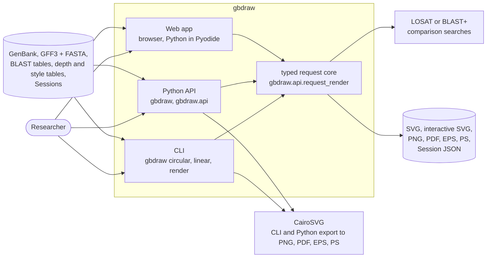
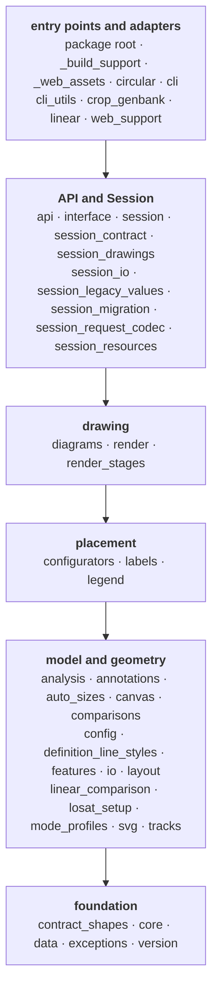
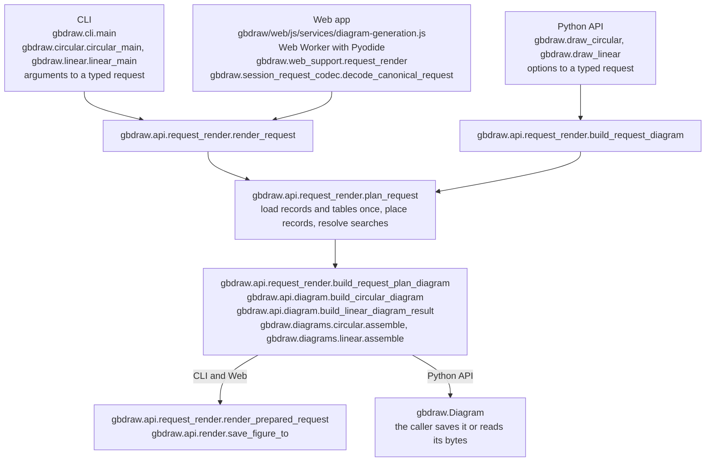
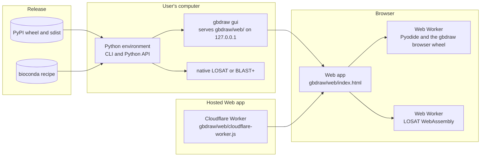

# gbdraw architecture

This page describes, for maintainers, what gbdraw is made of and how one
Generate runs through it. The rules that changes must keep are elsewhere: the
[architecture fitness-function ratchet](ARCHITECTURE_FITNESS_FUNCTION_RATCHET.md)
(its "Python structure" section holds the layer rule) and the Web design rules
in `gbdraw/web/CLAUDE.md`.

`python tools/generate_architecture_docs.py` writes the layer diagram below and
the unit list in the "Project Structure" section of `CLAUDE.md`.
`tests/test_architecture_docs.py` runs it with `--check`, which also fails when
this page names a `gbdraw` module, a name in one, or a repository path that no
longer exists. Write a name inside a class with the module that defines the
class: `gbdraw.interface.Diagram.save`, although the package root re-exports
`Diagram`.

## Context

One package serves three surfaces. Each turns its input into the same typed
request, and one core plans and draws it.

The Web app exports PNG and PDF in the page (`gbdraw/web/js/services/export.js`)
and runs LOSAT as WebAssembly (`gbdraw/web/wasm/losat/`). The CLI and the Python
API run a native LOSAT that `gbdraw setup-losat` installs
(`gbdraw.losat_setup`), or BLAST+.

## Building blocks

A unit is a subpackage of `gbdraw`, a module directly under it, or the package
root (`__init__`). `LAYERS` in `tests/test_python_structure_ratchet.py` puts
each unit in one layer, and a module imports from its own layer and the layers
below it. An arrow points to the layer below.

<!-- BEGIN GENERATED layers: python tools/generate_architecture_docs.py -->

<!-- END GENERATED layers -->

The role of each unit is the first line of its docstring; the "Project
Structure" section of `CLAUDE.md` lists them by layer. The imports that go up a
layer today are listed in `UPWARD_IMPORTS`, and the import cycles that imports
inside functions close are in `IMPORT_CYCLE_SIZES`; both may only shrink.
`gbdraw/web/` is the Web app, not a Python unit.

## Runtime: one Generate

1. A surface translates its input and nothing else. The CLI parses arguments
   into a request of `gbdraw.api.requests`. The Python API compiles its option
   objects (`gbdraw.interface`) into the same request. The Web app sends a
   canonical request document from the page to a Web Worker that runs gbdraw
   in Pyodide; `gbdraw.web_support.request_render` decodes it with
   `gbdraw.session_request_codec.decode_canonical_request`. Two CLI paths reach
   the same steps another way: `gbdraw render` draws a saved Session through
   `gbdraw.cli_utils.session.render_main`, and `--save-session` calls the
   steps below one by one to write the Session beside the figure.
2. `gbdraw.api.request_render.plan_request` reads the records and tables of the
   request once, places the records, and resolves comparison searches. The plan
   is the input of every later step.
3. `gbdraw.api.request_render.build_request_plan_diagram` builds the drawing:
   `gbdraw.api.diagram` hands the plan's records to `gbdraw.diagrams`, which
   assembles features, tracks, labels and the legend with the placement layer
   and the SVG groups and drawers of `gbdraw.render`.
4. The CLI and the Web app write the requested formats through
   `gbdraw.api.request_render.render_prepared_request`. The Web Worker also
   returns the interactive metadata the editors read and keeps parsed inputs
   and render stages for the next Generate
   (`gbdraw.api.prepared.PreparedBiologicalInputCache`). The Python API returns a
   `gbdraw.Diagram`, which writes a file or returns bytes when the caller asks.

## Deployment

- The wheel on PyPI holds the package, the Web app with its vendored assets
  (`gbdraw._web_assets`), and the browser wheel, so `gbdraw gui` works without
  a network. The bioconda recipe builds the release from its PyPI sdist.
- `tools/prepare_browser_wheel.py` builds the browser wheel: the package
  without the Web app, which the Web Worker installs into Pyodide.
- The hosted Web app is https://gbdraw.app/. `tools/prepare_cloudflare_pages.py`
  writes its bundle: the Web app, the browser wheel under a URL that carries
  its content hash, and the Gallery. `wrangler.toml` deploys the bundle with
  `gbdraw/web/cloudflare-worker.js`, which serves it and the Gallery assets.
  No server draws a diagram: every Generate runs in the browser.
